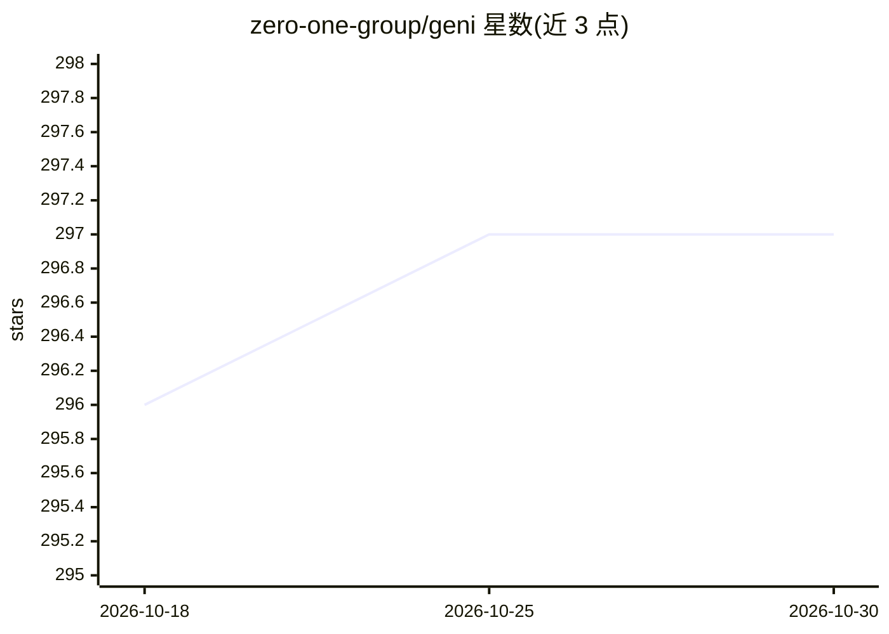

# zero-one-group/geni

⭐ 297 · Clojure · Apache-2.0 · 推送 2026-10-10 · [GitHub](https://github.com/zero-one-group/geni) · 组织维护

**Clojure 数据帧库：在 Apache Spark 上做数据处理与 ML**

Geni 是运行于 Apache Spark 之上的 Clojure 数据帧库，用 Clojure 的 -> 线程宏组合 Spark Dataset/Column 操作，免去 Java/Scala interop。0.4.0 版本新增 300+ Spark SQL 函数、输出 tech.ml.dataset/张量/Arrow、以及经 Spark Connect 运行的 Clojure UDF。同一 jar 兼容 Spark 3.5（Scala 2.12/2.13）与 Spark 4，要求 JDK 17 或 21、Clojure 1.11+，Spark 依赖由用户项目提供。支持 Spark ML 流水线、可选 XGBoost4J-Spark、JDBC 与 Excel 读写，另提供内嵌 REPL 的 CLI uberjar。

## 筛选速览

| 维度 | 判定 | 备注 |
|---|---|---|
| AI 角色 | `ai-enhanced` | 去掉 AI 部分产品仍成立 |
| 许可风险 | `permissive` | Apache-2.0 |
| 部署形态 | `None` |  |
| 模型依赖 | — | README 未给出锁定关系 |
| 硬件要求 | — | 无带数字的原话,不猜 |
| 安装摩擦 | `medium` | 含编译或系统依赖之一 |
| 成熟度 | — | 结构信号不足 |

## 能力要点

- 以 -> 线程宏组合 Spark Dataset/Column 操作的惯用 Clojure 接口
- 同一 jar 兼容 Spark 3.5（Scala 2.12/2.13）与 Spark 4，支持 Spark Connect
- 结果可输出为 tech.ml.dataset、张量与 Arrow 格式
- CLI uberjar 自带 Spark 3.5 与 nREPL 服务，一条命令进入 REPL

## 适用场景

- 在 Clojure REPL 中做 Spark 分布式数据清洗与变换
- 构建 Spark ML 流水线（含可选 XGBoost）做分类等任务
- 从 parquet/JDBC/Excel 读取数据做聚合分析与连接

## 场景标签

 · 领域:大数据/数据工程

## 证据(README 行号)

> L8: Geni (*/gɜni/* or "gurney" without the r) is a Clojure dataframe library that runs on Apache Spark. The name means "
> L14: Geni provides an idiomatic Spark interface for Clojure without the hassle of Java or Scala interop. It uses Clojure
> L29: Spark ML, with an example from Spark's programming guide:

## 星数曲线

2026-10-18 296 → 2026-10-30 297（+1）

---
*卡片 v1 · prompt 1.4 · 生成 2026-10-21 · 置信度 high · 依据 README sha `d61fc6fd3d25` · [字段定义](../../DATASET.md)*
