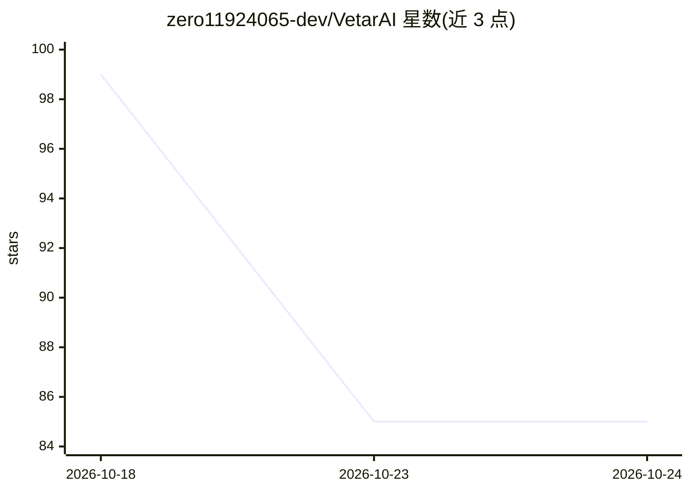

# zero11924065-dev/VetarAI

⭐ 85 · Swift · GPL-3.0 · 推送 2026-09-30 · [GitHub](https://github.com/zero11924065-dev/VetarAI) · 组织维护 · 中文 README

**本地多 Agent 编排桌面应用：知识仓库、可视化工作流、多模型工作室**

全原生 Swift 编写的 macOS（Apple Silicon）桌面应用，面向本地大模型用户：多 Agent 协作（主-子委派、圆桌讨论）、可视化工作流（推理/条件/循环/人工审批等节点）、拉模式知识仓库（勾选消息转为 Markdown 文件、永不自动注入）、bge-m3 三路检索（关键词/语义/混合）、多模型并行的超级工作室、CU 宏录制回放电脑操作。推理后端可切换：Ollama、任意 OpenAI 兼容服务或应用内模型包；数据保存在本地磁盘。以 dmg 安装包分发，已签名并公证。

## 筛选速览

| 维度 | 判定 | 备注 |
|---|---|---|
| AI 角色 | `ai-native` | 本体是模型或模型工具 |
| 许可风险 | `viral` | GPL-3.0 |
| 部署形态 | `desktop` | 安装包/桌面程序 |
| 模型依赖 | local-ok | 支持本地模型 |
| 硬件要求 | — | 无带数字的原话,不猜 |
| 安装摩擦 | `low` | 无编译、无系统依赖或容器化 |
| 成熟度 | — | 结构信号不足 |

## 能力要点

- 拉模式知识仓库：消息转 Markdown 文件、内容永不自动注入上下文
- bge-m3 INT8 三路检索：关键词（FTS5）/语义/混合
- 可视化工作流：循环节点支持分批、失败策略、人工审批节点
- 推理后端可切换：Ollama、任意 OpenAI 兼容服务或应用内模型包

## 适用场景

- 在本机运行多 Agent 协作完成复杂任务，不让对话和知识出本机
- 把批量任务（如数百张图 OCR）编排成可复用的工作流流水线
- 用知识仓库管理长期知识，显式搜索取回而非自动注入
- 把一个大任务交给多个模型并行处理并随时插话参与

## 场景标签

`多智能体` `工作流自动化` `知识库管理` · 领域:Agent 开发

## 证据(README 行号)

> L10: > VetarAI 是一款运行在本地的桌面应用：多 Agent 协作、可视化工作流、拉模式知识仓库 + 本地语义检索、多模型协作工作室。对话、知识库与项目数据全部留在你的磁盘上。
> L13: > VetarAI is an on-device desktop app: multi-agent collaboration, visual workflows, a pull-mode knowledge warehouse
> L15: **当前版本 / Current version：v0.7.15**（macOS · Apple Silicon · dmg · 已签名 + Apple 公证）

## 星数曲线

2026-10-18 99 → 2026-10-24 85（-14）

---
*卡片 v1 · prompt 1.4 · 生成 2026-10-24 · 置信度 high · 依据 README sha `c2f34af61f31` · [字段定义](../../DATASET.md)*
