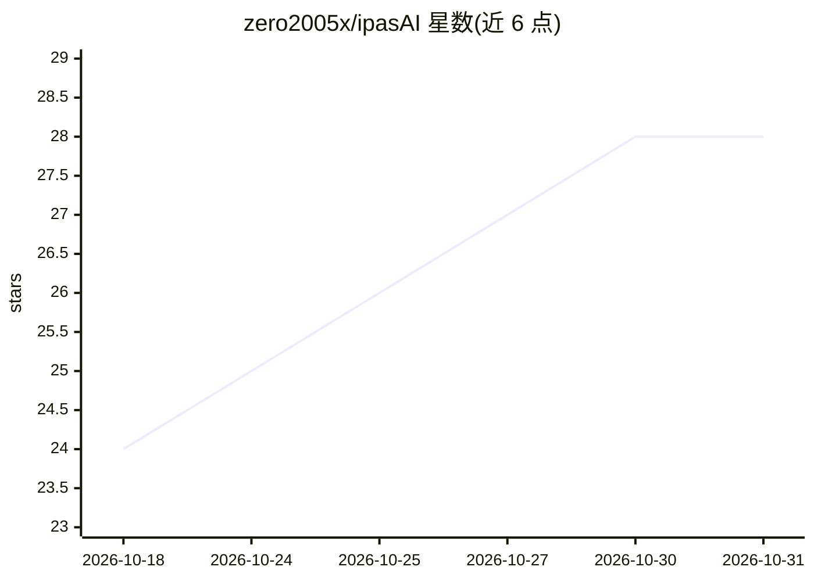

# zero2005x/ipasAI

⭐ 28 · Python · NOASSERTION · 推送 2026-09-25 · [GitHub](https://github.com/zero2005x/ipasAI) · 个人维护 · 中文 README

**iPAS AI 应用规划师（中级）备考开源教科书与题库（三册）**

对应台湾经济部 iPAS 人工智慧应用规划师（中级）检定的开放教材：三册共 34 章、约 80 万字 Markdown 书稿，覆盖共通必考科、数据分析路线与算法路线；配 219 题原创情境模拟题（含逐项解析）、300 题官方公告试题双向索引、110 题学习指引练习题对位。附 Python 校验管线（考纲规格查核）与基于 Headless 浏览器的课本风 PDF 编译工具，可从 Releases 直接下载成品 PDF。教科书内容采用 CC BY-NC-SA 4.0，工具代码采用 MIT，非官方发行品。

## 筛选速览

| 维度 | 判定 | 备注 |
|---|---|---|
| AI 角色 | `ai-knowledge` | 知识聚合/清单类 |
| 许可风险 | `permissive` | NOASSERTION |
| 部署形态 | `None` |  |
| 模型依赖 | — | README 未给出锁定关系 |
| 硬件要求 | — | 无带数字的原话,不猜 |
| 安装摩擦 | `low` | 无编译、无系统依赖或容器化 |
| 成熟度 | — | 结构信号不足 |

## 能力要点

- 三册 34 章、约 80 万字，对齐经济部 115.06 版考纲
- 219 题原创情境模拟题 + 300 题官方试题双向反查索引
- tools/build_pdf.py 编译 A4 课本风 PDF（可自定义 CSS）
- 内置考纲规格严格校验管线（check_book.py）

## 适用场景

- 系统备考 iPAS AI 应用规划师中级检定
- 按数据分析或算法路线选择对应分册精读
- 通过官方试题索引回测章节掌握程度并自编讲义

## 场景标签

`教程课程` · 领域:学习与行业

## 证据(README 行号)

> L13: 本專案為經濟部產業人才能力鑑定 **「iPAS 人工智慧應用規劃師（中級）」** 完整開源備考教科書與題庫體系（對應考綱規範：**經濟部 115.06 版**）。全書約 80 萬字、34 個章節，涵蓋共通必考科及雙專業路線，並配備
> L11: > iPAS AI 應用規劃師（中級）考綱教科書 v0.3 開源版 — 全套三冊完整教材 + 219 題原創情境模擬題 + 300 題官方試題解析索引 + 課本風 PDF 排版編譯工具鏈

## 星数曲线

2026-10-18 24 → 2026-10-31 28（+4）

---
*卡片 v1 · prompt 1.4 · 生成 2026-10-26 · 置信度 high · 依据 README sha `5ef91c18a267` · [字段定义](../../DATASET.md)*
