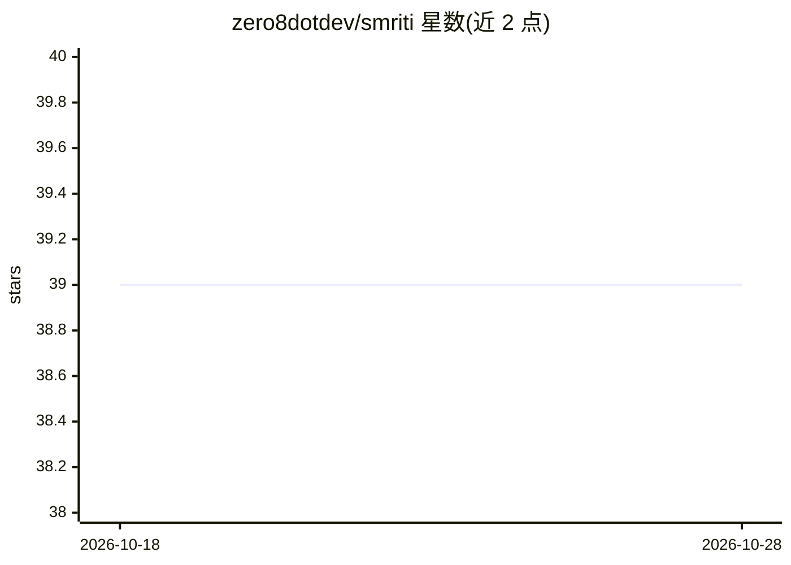

# zero8dotdev/smriti

⭐ 39 · TypeScript · MIT · 推送 2026-09-23 · [GitHub](https://github.com/zero8dotdev/smriti) · 个人维护

**AI 编程团队的共享记忆层：跨 agent 捕获、索引、召回会话**

面向使用 Claude Code、Cursor、Codex 等 AI agent 的工程团队的本地共享记忆工具：通过 hook 自动捕获 Claude Code 会话、按需 ingest 其他 agent 对话，建立全文与语义索引（SQLite 存储），以 recall/search 命令召回相关上下文，可选经本地 Ollama 合成摘要。团队通过 git 提交 .smriti/ 目录共享知识，无需云服务。构建于 QMD 之上，嵌入计算用 node-llama-cpp 本地完成。提供 macOS/Linux/Windows 安装脚本，需 Bun 与 Git，Jira 等集成尚未提供。

## 筛选速览

| 维度 | 判定 | 备注 |
|---|---|---|
| AI 角色 | `ai-ecosystem` | LLM/agent 周边工具 |
| 许可风险 | `permissive` | MIT |
| 部署形态 | `None` |  |
| 模型依赖 | local-ok | 支持本地模型 |
| 硬件要求 | — | 无带数字的原话,不猜 |
| 安装摩擦 | `low` | 无编译、无系统依赖或容器化 |
| 成熟度 | `idea` | |

## 能力要点

- hook 自动捕获 Claude Code 会话，按需 ingest Codex/Cursor 等多 agent 对话
- 全文+语义双索引，会话按项目/agent/类别自动打标
- 团队经 git 共享知识（smriti share/sync），无云服务
- 生成 .smriti/CLAUDE.md 供 Claude Code 会话自动发现共享知识

## 适用场景

- 跨会话召回团队已有的技术决策与调试结论，避免重复工作
- 把分散在各 agent 聊天记录里的知识沉淀为可搜索的团队记忆
- 在本地完全私有（无云端）条件下给 agent 注入历史上下文

## 场景标签

`Agent 记忆` · 领域:Agent 开发

## 证据(README 行号)

> L52: Smriti is a shared memory layer that sits underneath your AI agents.
> L67: Built on top of QMD by Tobi Lütke. Everything
> L168: Everything runs locally. Your conversations never leave your machine. The SQLite

## 星数曲线

2026-10-18 39 → 2026-10-28 39（+0）

---
*卡片 v1 · prompt 1.4 · 生成 2026-10-25 · 置信度 high · 依据 README sha `268bea66afdd` · [字段定义](../../DATASET.md)*
