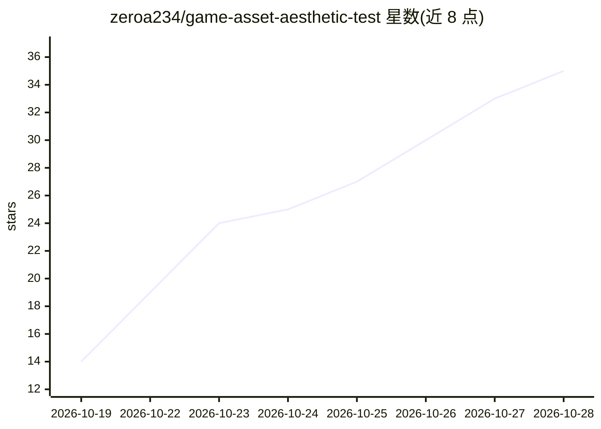

# zeroa234/game-asset-aesthetic-test

⭐ 35 · Python · 推送 2026-10-18 · [GitHub](https://github.com/zeroa234/game-asset-aesthetic-test) · 个人维护 · 中文 README

**面向游戏美术 Agent 的 8 个技能包：像素精灵、Spine 动画、方块角色与 TTS 配音**

一套可独立携带的 Agent Skills 库，覆盖三类工作：视频转循环像素精灵与 Spine 切件/立绘/多视角骨骼动画、Blockbench 方块角色（比例模板、发型、模型检查）、虚构音色 TTS 讲解配音。每个技能包含 SKILL.md 入口、参考文档与配套代码，保留已验证/失败/待验证的区分，附离线检查记录与 manifest.json 记录代码来源与哈希。使用方式为 git clone 后复制技能目录到 Agent 的 skills 位置，图像层、模型权重与第三方插件需使用者自行准备。路线中涉及 FFmpeg、ComfyUI、Spine、Godot、Blender、Blockbench 等工具。

## 筛选速览

| 维度 | 判定 | 备注 |
|---|---|---|
| AI 角色 | `ai-ecosystem` | LLM/agent 周边工具 |
| 许可风险 | `none` | — |
| 部署形态 | `None` |  |
| 模型依赖 | — | README 未给出锁定关系 |
| 硬件要求 | — | 无带数字的原话,不猜 |
| 安装摩擦 | `medium` | 含编译或系统依赖之一 |
| 成熟度 | — | 结构信号不足 |

## 能力要点

- 8 个独立技能覆盖像素精灵、Spine 骨骼动画、方块角色与 TTS 配音
- 每包含 SKILL.md 入口、references 参考文档与配套代码，可独立携带
- 6 组离线检查记录与 manifest.json 代码来源/哈希追踪
- 技能内区分已验证、失败与待验证状态，写明运行时与游戏集成边界

## 适用场景

- 把角色跑步视频做成循环像素精灵表
- 从立绘或侧视部件生成 Spine 骨骼动画并接入 Godot/three.js
- 用 Blockbench 比例模板生成方块角色并做模型检查
- 为游戏演示生成虚构音色的中文讲解配音

## 场景标签

`图像生成` `语音合成` `图像视频处理` · 领域:内容生成

## 证据(README 行号)

> L23: **8 个独立技能，覆盖三类工作：** 2D 像素精灵与 Spine 骨骼、方块角色、讲解配音。可以只挑一条路线，也可以把生成、绑定、检查串起来用。
> L110: 从 `extensions/skills/` 中复制所需目录到你的 Agent 支持的 skills 位置。保留整个目录，入口、参考和代码一起携带。
> L122: 尚未安装时，也可以让 Agent 直接读取所选目录的 `SKILL.md`。运行配套代码前，先读该包的 `references/implementation.md`，再按实际路线准备环境和输入。

## 星数曲线

2026-10-19 14 → 2026-10-28 35（+21）

---
*卡片 v1 · prompt 1.4 · 生成 2026-10-26 · 置信度 high · 依据 README sha `e36a549a4754` · [字段定义](../../DATASET.md)*
