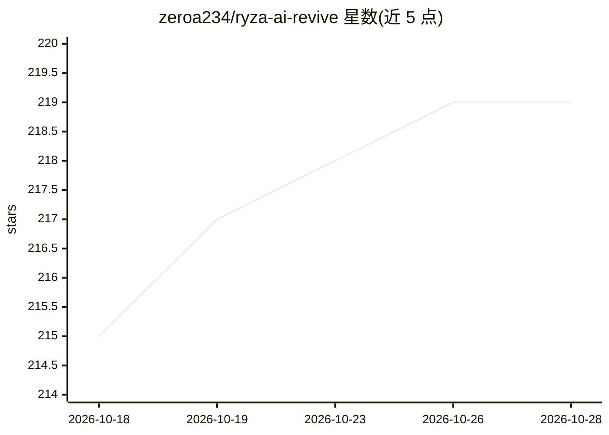

# zeroa234/ryza-ai-revive

⭐ 219 · JavaScript · MIT · 推送 2026-10-05 · [GitHub](https://github.com/zeroa234/ryza-ai-revive) · 个人维护 · 中文 README

**带实时 2D 立绘的本地优先 AI 对话陪伴客户端**

面向终端用户的莱莎 AI 陪伴客户端：静态 HTML/JavaScript 核心，Windows（Electron）与 Android（WebView）提供原生宿主，渲染 Spine 4.2 实时立绘。模型不随仓库分发，运行时通过操作者配置的 OpenAI 兼容 chat completions HTTP API 接入 LLM，可选 TTS 后端（openai/qwen/fish）。含对话/故事/沉浸等多种模式、本地 RPG 状态（体力/任务/背包）、三层记忆与 NSFW 默认关闭的显式开关；密钥留在本地应用配置，打包前经隐私检查门禁。

## 筛选速览

| 维度 | 判定 | 备注 |
|---|---|---|
| AI 角色 | `ai-native` | 本体是模型或模型工具 |
| 许可风险 | `permissive` | MIT |
| 部署形态 | `library` | 以包/库形式分发 |
| 模型依赖 | — | README 未给出锁定关系 |
| 硬件要求 | — | 无带数字的原话,不猜 |
| 安装摩擦 | `medium` | 含编译或系统依赖之一 |
| 成熟度 | — | 结构信号不足 |

## 能力要点

- 三端共用 /_proxy 代理契约，规避 CORS 调用操作者端点
- OpenAI 兼容 API 接入 LLM，可选 openai/qwen/fish TTS 后端
- Spine 4.2 实时立绘与本地 RPG 状态、三层会话记忆
- privacy_check.py 打包门禁阻止密钥进入发行包

## 适用场景

- 在 Windows/Android 上与自定义 LLM 后端的角色陪伴对话
- 接入自己选择的大模型与语音合成服务运行本地客户端
- 通过浏览器开发服务器运行或打包 NSIS/APK 发行

## 场景标签

`聊天机器人` · 领域:对话与助手

## 证据(README 行号)

> L3: A local-first client for a conversational agent with a real-time 2D avatar.
> L5: The application is a static HTML/JavaScript runtime. Thin native hosts load the same tree on Windows (Electron) and 
> L25: Inference is not bundled. Settings require an OpenAI-compatible base URL, model identifier, and API key; TTS is opt

## 星数曲线

2026-10-18 215 → 2026-10-28 219（+4）

---
*卡片 v1 · prompt 1.4 · 生成 2026-10-22 · 置信度 high · 依据 README sha `a8ed93edbc64` · [字段定义](../../DATASET.md)*
