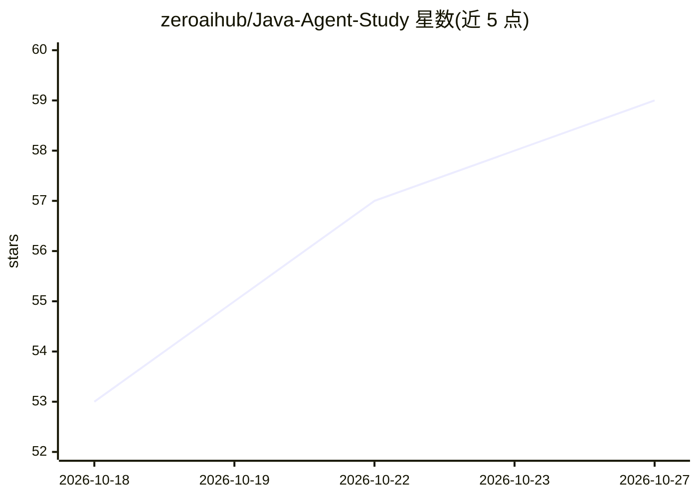

# zeroaihub/Java-Agent-Study

⭐ 59 · Java · MIT · 推送 2026-10-17 · [GitHub](https://github.com/zeroaihub/Java-Agent-Study) · 组织维护 · 中文 README

**Java 开发者转型 AI Agent 工程师的 30 天学习路线与实战源码**

面向 Java 开发者的系统化学习项目，以 30 个独立 Day 模块覆盖 LLM API、Function Calling、Memory、RAG、Workflow、MCP、Multi-Agent、浏览器/规划/长任务/企微/知识平台/代码生成等主题，技术栈为 Java 21 + Spring Boot + Spring AI，通过 OpenAI Compatible API 接入 LM Studio / DeepSeek / 通义等服务。Day01-17 已实现（部分为骨架/演示阶段），Day18-30 仅为规划。限制：向量存储与记忆为内存实现、全仓库无测试、无 Dockerfile。

## 筛选速览

| 维度 | 判定 | 备注 |
|---|---|---|
| AI 角色 | `ai-knowledge` | 知识聚合/清单类 |
| 许可风险 | `permissive` | MIT |
| 部署形态 | `self-host` | docker 或自建部署 |
| 模型依赖 | — | README 未给出锁定关系 |
| 硬件要求 | — | 无带数字的原话,不猜 |
| 安装摩擦 | `low` | 无编译、无系统依赖或容器化 |
| 成熟度 | `idea` | |

## 能力要点

- 30 天模块化学习路线，Day01-17 已实现并附可运行 Demo
- Spring AI + OpenAI Compatible API（LM Studio / DeepSeek / 通义）接入模型
- Day15-16 实现多租户企业知识平台与 RAG 链路（混合检索、RRF、权限、评测）
- Day17 实现 Code Agent（VFS、SEARCH/REPLACE 补丁、沙箱、编译验证）

## 适用场景

- Java 开发者系统学习 AI Agent 开发并动手跑通各模块源码
- 参考企业级 RAG / 知识平台 / 代码生成 Agent 的工程实现
- 在本地 LM Studio 或 OpenAI 兼容服务上运行各类 Agent 示例

## 场景标签

`教程课程` · 领域:学习与行业

## 证据(README 行号)

> L3: **从 Java 开发者到 AI Agent 工程师的 30 天实战之路**
> L15: 本项目是一个 **Java 开发者系统转型 AI Agent 工程师** 的完整学习路线与实战源码集合。
> L17: > 目标不是研究大模型算法，而是成为能够独立设计、开发、部署和商业化 AI Agent 的高级工程师。

## 星数曲线

2026-10-18 53 → 2026-10-27 59（+6）

---
*卡片 v1 · prompt 1.4 · 生成 2026-10-24 · 置信度 mid · 依据 README sha `eac430920110` · [字段定义](../../DATASET.md)*
