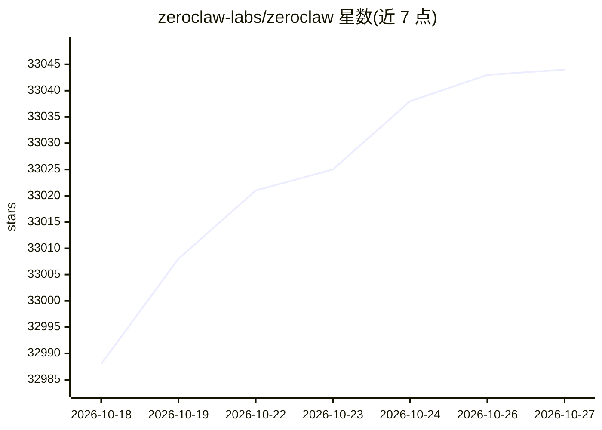

# zeroclaw-labs/zeroclaw

⭐ 33,044 · Rust · Apache-2.0 · 推送 2026-10-26 · [GitHub](https://github.com/zeroclaw-labs/zeroclaw) · [官网](https://www.zeroclaw.com/) · 组织维护

**个人 AI 助手运行时：单二进制 Rust 程序，多渠道多模型自托管**

ZeroClaw 是一个以单个 Rust 二进制分发的 agent 运行时，用户在本机配置运行：通过 30+ 渠道（Discord、Telegram、Matrix、邮件、webhook、CLI 等）收发消息，接入约 20 余家 LLM 提供商并可配置 fallback 链与路由，通过 shell、浏览器、HTTP、硬件、自定义 MCP 服务器等工具执行动作。默认自治级别为 supervised，中等风险操作需审批、高风险被阻止，支持 Landlock/Bubblewrap/Seatbelt/Docker 沙箱与工具回执。配置为单个 TOML 文件，可注册为系统服务常驻运行。

## 筛选速览

| 维度 | 判定 | 备注 |
|---|---|---|
| AI 角色 | `ai-native` | 本体是模型或模型工具 |
| 许可风险 | `dual` | Apache-2.0 |
| 部署形态 | `None` |  |
| 模型依赖 | local-ok | 支持本地模型 |
| 硬件要求 | — | 无带数字的原话,不猜 |
| 安装摩擦 | `low` | 无编译、无系统依赖或容器化 |
| 成熟度 | — | 结构信号不足 |

## 动量与使用信号

- 维护:`active` — 距上次 push 0.7 天,年发版 100,420 位贡献者
- 涨星:近 1 天 **+4**(自 20261016 起算)
- 平台:WINDOWS / MACOS / LINUX · 协议:OPENAI-API / MCP / OLLAMA

## 能力要点

- 单 Rust 二进制，本地运行，数据与密钥留在用户机器
- 30+ 消息渠道适配器与可插拔模型提供商（含 fallback 链）
- supervised 默认自治模式、OS 级沙箱与每次动作的加密工具回执
- 通过 Peripheral trait 支持 Raspberry Pi、STM32、Arduino、ESP32 的 GPIO/I2C/SPI/USB

## 适用场景

- 在一台自己的机器上部署跨 Discord/Telegram 等渠道的常驻个人助手
- 配置多个 LLM 提供商并在故障时自动切换
- 在树莓派等设备上让 agent 控制硬件外设
- 通过 MQTT/webhook/cron 事件触发带审批门的标准作业流程

## 场景标签

`AI 助手` · 领域:对话与助手

## 证据(README 行号)

> L21: ZeroClaw is an agent runtime — a single Rust binary you configure and run. It talks to LLM providers (Anthropic, Op
> L67: - **Provider-agnostic** — model providers are pluggable. Configure Anthropic, OpenAI, local Ollama, or any OpenAI-c
> L68: - **Security-first, with escape hatches** — default autonomy is `supervised`: medium-risk ops require approval, hig

## 星数曲线

2026-10-18 32,988 → 2026-10-27 33,044（+56）

---
*卡片 v1 · prompt 1.4 · 生成 2026-10-18 · 置信度 high · 依据 README sha `b9d247c74b44` · [字段定义](../../DATASET.md)*
