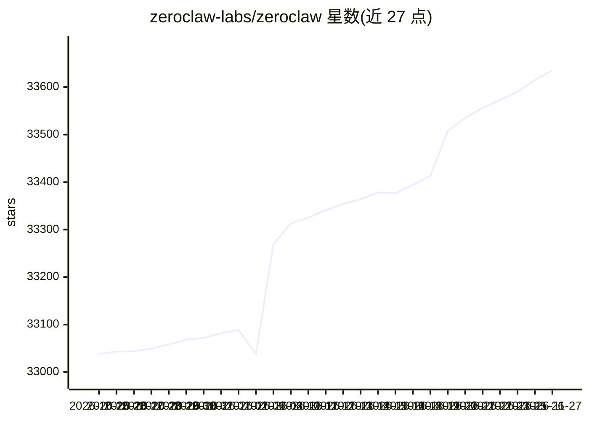

# zeroclaw-labs/zeroclaw

⭐ 33,635 · Rust · Apache-2.0 · 推送 2026-11-26 · [GitHub](https://github.com/zeroclaw-labs/zeroclaw) · [官网](https://www.zeroclaw.com/) · 组织维护

**单二进制 Rust agent 运行时：自托管多渠道个人 AI 助手**

ZeroClaw 是以单个 Rust 二进制发布的 agent 运行时：配置后在本机运行，接入约 20 余家 LLM 提供商（Anthropic、OpenAI、本地 Ollama 及任意 OpenAI 兼容端点，支持回退链），通过 30+ 渠道（Discord、Telegram、Matrix、邮件、webhook、CLI）收发消息，并以工具（shell、浏览器、HTTP、GPIO 硬件、自定义 MCP 服务器）执行动作。默认自治级别为 supervised：中风险操作需审批、高风险被阻止，配合 Landlock/Bubblewrap/Seatbelt/Docker 沙箱与加密工具凭据。TOML 单文件配置，可注册为 systemd/launchctl/Windows 服务常驻。

## 筛选速览

| 维度 | 判定 | 备注 |
|---|---|---|
| AI 角色 | `ai-ecosystem` | LLM/agent 周边工具 |
| 许可风险 | `permissive` | Apache-2.0 |
| 部署形态 | `None` |  |
| 模型依赖 | local-ok | 支持本地模型 |
| 硬件要求 | — | 无带数字的原话,不猜 |
| 安装摩擦 | `low` | 无编译、无系统依赖或容器化 |
| 成熟度 | — | 结构信号不足 |

## 动量与使用信号

- 维护:`active` — 距上次 push 0.7 天,年发版 100,420 位贡献者
- 涨星:近 1 天 **+4**(自 20261016 起算)
- 平台:WINDOWS / MACOS / LINUX · 协议:OPENAI-API / MCP / OLLAMA

## 能力要点

- 单一 Rust 二进制运行时，密钥与数据留在本机
- Provider 可插拔（Anthropic/OpenAI/Ollama/OpenAI 兼容端点）并带回退链路由
- 30+ 消息渠道与工具体系（shell/浏览器/HTTP/GPIO/MCP）
- supervised 默认自治、OS 级沙箱与加密工具凭据

## 适用场景

- 在自己机器上部署跨 Discord/Telegram/邮件等渠道的 AI 助手
- 以 CLI 交互对话并让 agent 执行 shell/浏览器工具操作
- 在树莓派/ESP32 等设备上通过 GPIO/I2C/SPI 驱动硬件

## 场景标签

`AI 助手` `Agent 框架` · 领域:Agent 开发

## 证据(README 行号)

> L21: ZeroClaw is an agent runtime — a single Rust binary you configure and run. It talks to LLM providers (Anthropic, Op
> L67: - **Provider-agnostic** — model providers are pluggable. Configure Anthropic, OpenAI, local Ollama, or any OpenAI-c
> L68: - **Security-first, with escape hatches** — default autonomy is `supervised`: medium-risk ops require approval, hig

## 星数曲线

2026-10-25 33,038 → 2026-11-27 33,635（+597）

---
*卡片 v1 · prompt 1.4 · 生成 2026-11-22 · 置信度 high · 依据 README sha `13bcd9743c6c` · [字段定义](../../DATASET.md)*
