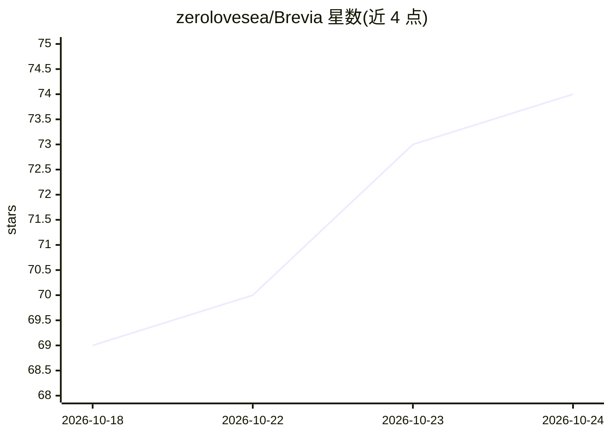

# zerolovesea/Brevia

⭐ 74 · JavaScript · ISC · 推送 2026-10-22 · [GitHub](https://github.com/zerolovesea/Brevia) · [官网](https://brevia.work) · 个人维护 · 中文 README

**本地优先的 AI 会议助手：录音转写、AI 笔记与纪要**

开源 AI 会议助手，覆盖桌面端（Electron）与手机端（Flutter）：电脑或手机录音后实时转写（30+ 种语言）、生成可编辑笔记与会议纪要、说话人分离与字幕翻译。语音识别与本地 AI（MLX / sherpa-onnx / llama.cpp 推理）在用户电脑运行，无需账号，模型按需从应用内下载，可完全离线；也可选择在线 AI 服务。手机与电脑通过局域网 HTTPS 同步，手机可作为远程麦克风。导出支持 Markdown、TXT、JSON、SRT、DOCX、PDF 等。

## 筛选速览

| 维度 | 判定 | 备注 |
|---|---|---|
| AI 角色 | `ai-native` | 本体是模型或模型工具 |
| 许可风险 | `permissive` | ISC |
| 部署形态 | `None` |  |
| 模型依赖 | — | README 未给出锁定关系 |
| 硬件要求 | — | 无带数字的原话,不猜 |
| 安装摩擦 | `low` | 无编译、无系统依赖或容器化 |
| 成熟度 | — | 结构信号不足 |

## 能力要点

- 本地处理：转写、说话人分离与本地 AI 均在电脑端运行，可离线
- 实时转写支持 30+ 种语言，模型在设置→模型库按需下载
- 手机端录音/标记重点/充当麦克风，与电脑局域网 HTTPS 协作
- 导出 Markdown/TXT/JSON/SRT/DOCX/PDF，录音导出 WAV

## 适用场景

- 会议与访谈录音并在本地转写、提炼决定与待办
- 手机随身录音，回到电脑继续整理纪要
- 无账号、数据不出设备的会议记录流程

## 场景标签

 · 领域:语音转写/会议效率工具

## 证据(README 行号)

> L3:  专注对话，留下重点。 开源、本地优先的 AI 会议助手。 录下会议与访谈，实时转写、提炼重点、整理纪要。电脑本地处理，手机随身记录。
> L99: - **本机处理。** 语音识别与说话人处理在自己的电脑运行。下载所需模型后，AI 笔记、纪要和翻译也可离线完成。
> L122: - **本地处理：** Python Worker 调度音频与模型，MLX / sherpa-onnx 负责语音推理，llama.cpp 运行本地 AI。

## 星数曲线

2026-10-18 69 → 2026-10-24 74（+5）

---
*卡片 v1 · prompt 1.4 · 生成 2026-10-24 · 置信度 high · 依据 README sha `07ae8db99433` · [字段定义](../../DATASET.md)*
