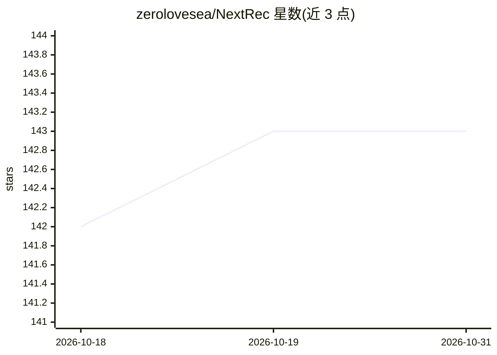

# zerolovesea/NextRec

⭐ 143 · Python · MIT · 推送 2026-06-01 · [GitHub](https://github.com/zerolovesea/NextRec) · [官网](http://zerolovesea.github.io/NextRec/zh/) · 个人维护 · 中文 README

**基于 PyTorch 的统一推荐系统框架，供研究与工程团队建模训练**

NextRec 是基于 PyTorch 的推荐系统框架，面向研究工程团队与推荐算法学习者，提供排序、召回、序列推荐、多任务与预训练共五类模型的实现（含 DeepFM、DSSM、SASRec、MMOE、RQ-VAE 等），配套统一特征工程与数据流水线、命令行工具 NextCLI、实验跟踪（Wandb/Swanlab/Tensorboard）与 ONNX 导出。通过 pip 安装，要求 Python 3.10+，召回检索依赖 FAISS 需额外安装。部分传统模型（BPR/MF/LightGCN 等）标注开发中。

## 筛选速览

| 维度 | 判定 | 备注 |
|---|---|---|
| AI 角色 | `ai-ecosystem` | LLM/agent 周边工具 |
| 许可风险 | `permissive` | MIT |
| 部署形态 | `library` | 以包/库形式分发 |
| 模型依赖 | — | README 未给出锁定关系 |
| 硬件要求 | — | 无带数字的原话,不猜 |
| 安装摩擦 | `low` | 无编译、无系统依赖或容器化 |
| 成熟度 | — | 结构信号不足 |

## 能力要点

- 覆盖排序/召回/序列/多任务/预训练五类模型，各附论文出处与支持状态
- 统一的特征定义、数据处理与分布式训练/推理流水线
- 命令行工具按 YAML 配置一键启动训练与推理，支持本地文档与可视化平台
- 支持 ONNX 导出与 ONNX Runtime 推理（可选 extra）

## 适用场景

- 复现推荐系统学术论文并快速训练验证
- 业务算法工程师搭建 CTR/召回/多任务模型的训练推理流程
- 推荐算法学习者通过示例代码与模型注解了解模型架构

## 场景标签

`推荐系统` · 领域:学习与行业

## 证据(README 行号)

> L17: NextRec是一个基于PyTorch的现代推荐系统框架，旨在为研究工程团队提供快速的建模、训练与评估流。框架内置丰富的模型库、数据处理工具和工程化训练组件。此外提供了易上手的接口，命令行工具及教程，推荐算法学习者能以最快速度了解
> L20: - **多场景推荐能力**：覆盖排序（CTR/CVR）、匹配、多任务学习、生成式召回等推荐/营销模型，持续跟进业界进展。

## 星数曲线

2026-10-18 142 → 2026-10-31 143（+1）

---
*卡片 v1 · prompt 1.4 · 生成 2026-10-22 · 置信度 high · 依据 README sha `f6278ced605f` · [字段定义](../../DATASET.md)*
