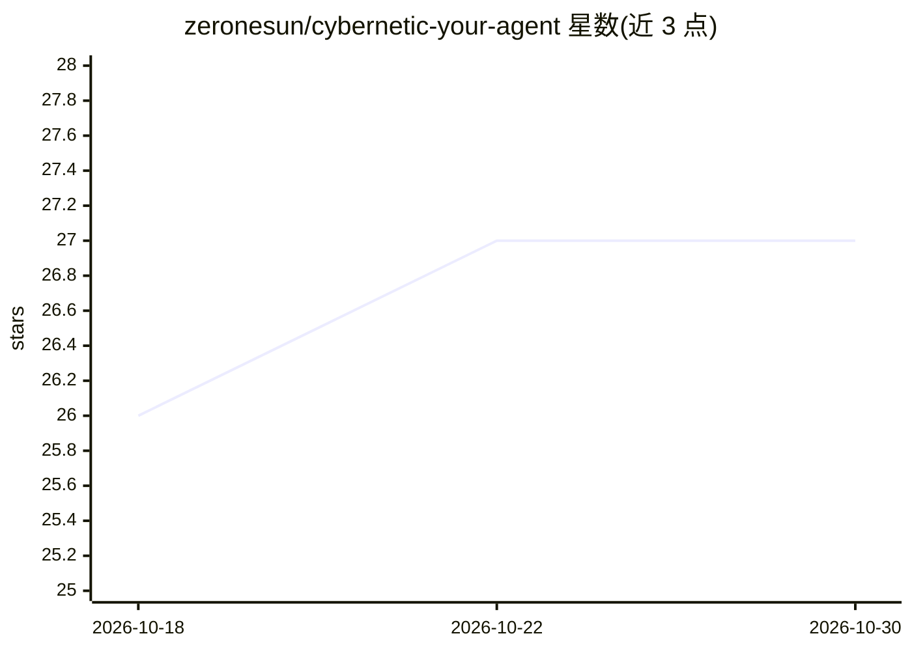

# zeronesun/cybernetic-your-agent

⭐ 27 · MIT · 推送 2026-10-03 · [GitHub](https://github.com/zeronesun/cybernetic-your-agent) · 个人维护 · 中文 README

**用钱学森工程控制论重组 AI Agent 记忆与技能架构的教程**

一套纯教程仓库（无代码库/API）：将工程控制论的前馈、积分控制、层级分离、自监控四个概念，适配到 Hermes 3、Claude（with MCP）、自定义 GPTs 等具备持久化记忆与技能模块的 Agent 平台。不增加 prompt 条目、不引入新模型，通过架构重组实现任务前加载偏好教训、二次错误下沉为规则、记忆/技能分层存储、输出前自检闸门与每周自动复盘。部署方式是把一句训练指令发给 Agent 或按第五章指令手动复制操作，仓库另提供指令提取版与示例文件。

## 筛选速览

| 维度 | 判定 | 备注 |
|---|---|---|
| AI 角色 | `ai-knowledge` | 知识聚合/清单类 |
| 许可风险 | `permissive` | MIT |
| 部署形态 | `None` |  |
| 模型依赖 | — | README 未给出锁定关系 |
| 硬件要求 | — | 无带数字的原话,不猜 |
| 安装摩擦 | `low` | 无编译、无系统依赖或容器化 |
| 成熟度 | — | 结构信号不足 |

## 能力要点

- 四个控制论概念：前馈避坑、积分防震荡、层级分离、交付自检
- 三层记忆体 + 技能层架构，记忆只存'为什么'、技能只存'怎么做'
- 一句指令触发 Agent 自动完成整套训练（约 40 分钟）
- 适配 Hermes 3 / Claude（with MCP）/ 自定义 GPTs，无技能平台可降阶运行

## 适用场景

- 让自己的 AI Agent 记住偏好和历史教训，减少重复纠正
- 为 Agent 建立分层记忆与技能架构
- 让 Agent 交付前自动自检并定期复盘进化

## 场景标签

`教程课程` · 领域:学习与行业

## 证据(README 行号)

> L9: 一套完整、可复制的实操教程。
> L11: 将钱学森《工程控制论》的核心思想适配到现代 AI Agent 平台（Hermes、Claude with MCP、自定义 GPTs 等）。不增加 prompt 条目，不引入新模型，而是**通过架构重组**让 Agent 实现：
> L30: 2. 阅读教程（建议按顺序，或至少先读第一章确认思路）

## 星数曲线

2026-10-18 26 → 2026-10-30 27（+1）

---
*卡片 v1 · prompt 1.4 · 生成 2026-10-26 · 置信度 high · 依据 README sha `73c00a60a25d` · [字段定义](../../DATASET.md)*
