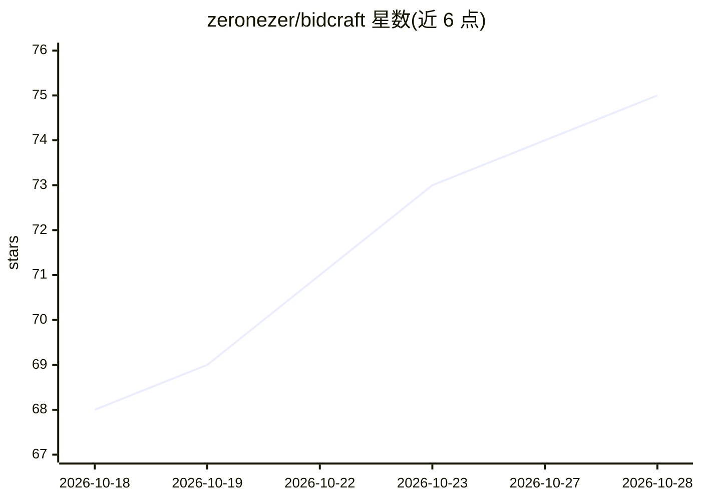

# zeronezer/bidcraft

⭐ 75 · Python · Apache-2.0 · 推送 2026-10-09 · [GitHub](https://github.com/zeronezer/bidcraft) · 个人维护 · 中文 README

**对话式工程标书编制智能体，AI 生成技术标初稿**

面向工程建设投标场景的开源 Web 应用：上传招标文件（PDF/扫描件经 MinerU OCR 解析，Word/Excel 走专用通道），结构化落库标段、评分办法与编制要求；基于 LangGraph 的对话式智能体通过 15 个工具完成目录生成、逐章编写思路、正文流式生成与重写。配套历史施组知识库（LLM-Wiki 路线）、全局事实表（数字有出处）、经验学习与 Mermaid 关系图。技术栈 FastAPI + Vue 3，需自备阿里云百炼 API Key 与 MySQL 8，Word/PDF 导出等尚在规划中。

## 筛选速览

| 维度 | 判定 | 备注 |
|---|---|---|
| AI 角色 | `ai-native` | 本体是模型或模型工具 |
| 许可风险 | `permissive` | Apache-2.0 |
| 部署形态 | `self-host` | docker 或自建部署 |
| 模型依赖 | — | README 未给出锁定关系 |
| 硬件要求 | — | 无带数字的原话,不猜 |
| 安装摩擦 | `low` | 无编译、无系统依赖或容器化 |
| 成熟度 | — | 结构信号不足 |

## 能力要点

- 招标文件解析：标段划分、评分办法、技术要求、规定目录结构化落库
- 对话式智能体可调用 15 个工具，含执行结果核验机制
- 全局事实表：每条数字标明出处，正文引用可追溯
- 历史施组自动提炼为结构化知识页，改稿偏好可沉淀复用

## 适用场景

- 投标团队用它起草技术标初稿，人工只做审核与补图
- 把历史中标施组建为知识库，跨项目复用编制经验
- 多标段项目按标段隔离事实与素材，避免内容串段

## 场景标签

`AI 写作` `RAG` `文档解析` · 领域:内容生成

## 证据(README 行号)

> L5: **开源 · 对话式 · 工程标书编制智能体**
> L7: 让 AI 写完技术标的初稿，你只做审核和补图。
> L56: |💬 **对话式编制**|不说"点击按钮"，直接说人话："第三章重写一下，突出隧道超前地质预报"、"把工期那几个数字统一成 26 个月"。模型自主决定调哪些工具|

## 星数曲线

2026-10-18 68 → 2026-10-28 75（+7）

---
*卡片 v1 · prompt 1.4 · 生成 2026-10-24 · 置信度 mid · 依据 README sha `ab08e6d49fa5` · [字段定义](../../DATASET.md)*
