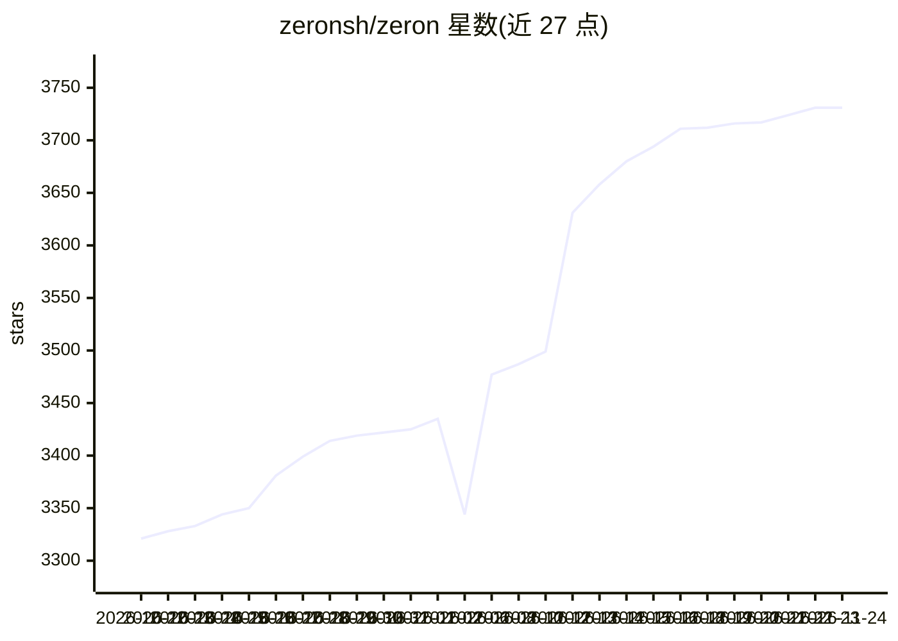

# zeronsh/zeron

⭐ 3,740 · Rust · MIT · 推送 2026-11-24 · [GitHub](https://github.com/zeronsh/zeron) · [官网](https://zeron.sh) · 个人维护 · 中文 README

**本地控制面板：统一管理多个编码代理的会话**

面向开发者的编码代理控制面板，默认在本地运行，可从单一桌面应用控制 Claude Code、Codex、Cursor、Devin 等 11 种编码代理。桌面版基于原生 Rust 与支持热重载 Luau UI 的 zgx 构建，支持插件、模板与主题，可自更新；提供面向无显示服务器（如 VPS）的 Linux CLI，以后台服务形式常驻引擎，支持开机存活；可选多设备同步，登录后可在另一设备接续或驱动代理，本地会话默认不上传。

## 筛选速览

| 维度 | 判定 | 备注 |
|---|---|---|
| AI 角色 | `ai-ecosystem` | LLM/agent 周边工具 |
| 许可风险 | `permissive` | MIT |
| 部署形态 | `desktop` | 安装包/桌面程序 |
| 模型依赖 | — | README 未给出锁定关系 |
| 硬件要求 | — | 无带数字的原话,不猜 |
| 安装摩擦 | `low` | 无编译、无系统依赖或容器化 |
| 成熟度 | — | 结构信号不足 |

## 能力要点

- 桌面应用统一控制 11 种编码代理，默认本地运行、无需账号
- Linux 无头 CLI 安装为后台服务，支持开机后继续运行代理
- 可选多设备同步，跨设备读取/写入工作区文件
- 基于 zgx 的插件、模板与主题机制，支持自更新

## 适用场景

- 在同一界面里切换和驱动多个编码代理会话
- 在 VPS 上挂机运行代理，合上笔记本后任务继续
- 在多台设备间接续查看或操控同一个代理任务

## 场景标签

`编码 Agent` · 领域:编码与开发

## 证据(README 行号)

> L3: Control your coding agents (Claude Code, Codex, Cursor, OpenCode, Devin, Grok, Hermes, Pi, Antigravity, Muse Code, f
> L17: No account or network connection is needed; sessions stay on your device. The desktop app is built on zgx (native R

## 星数曲线

2026-10-22 3,321 → 2026-11-24 3,731（+410）

---
*卡片 v1 · prompt 1.4 · 生成 2026-11-24 · 置信度 high · 依据 README sha `8d3b719ee22d` · [字段定义](../../DATASET.md)*
