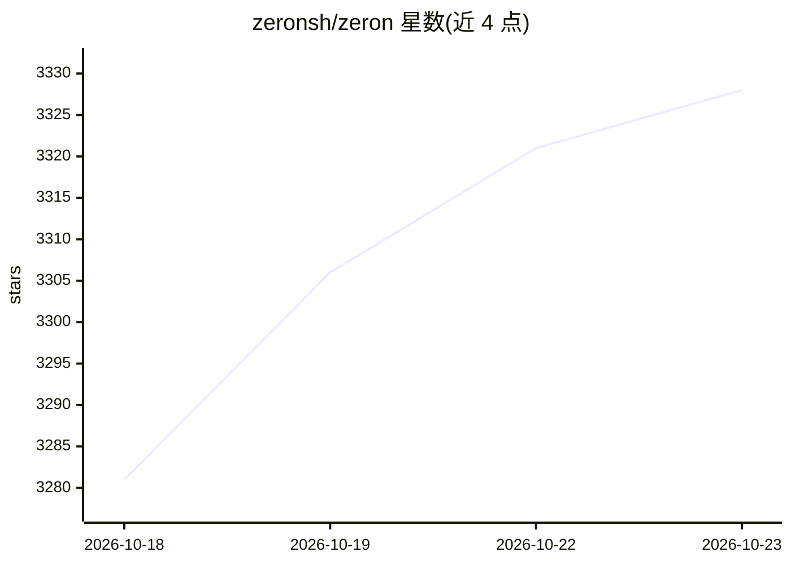

# zeronsh/zeron

⭐ 3,328 · Rust · MIT · 推送 2026-10-22 · [GitHub](https://github.com/zeronsh/zeron) · [官网](https://zeron.sh) · 组织维护 · 中文 README

**本地优先的编码 agent 控制面板：管理与监控多种 coding agent**

用 Rust/GPUI 构建的桌面应用（含 Linux headless CLI），用于在本地控制 Claude Code、Codex、Cursor、Devin 等编码 agent：默认无需账号与网络连接，会话保存在本机，应用可自更新。可选登录账号实现多设备同步，在一台设备启动 agent 后可从其他设备查看或驱动；同账号设备可互访工作区文件。CLI 安装器在 Linux 上以后台服务方式运行引擎并可跨重启存活。

## 筛选速览

| 维度 | 判定 | 备注 |
|---|---|---|
| AI 角色 | `ai-ecosystem` | LLM/agent 周边工具 |
| 许可风险 | `permissive` | MIT |
| 部署形态 | `desktop` | 安装包/桌面程序 |
| 模型依赖 | — | README 未给出锁定关系 |
| 硬件要求 | — | 无带数字的原话,不猜 |
| 安装摩擦 | `low` | 无编译、无系统依赖或容器化 |
| 成熟度 | — | 结构信号不足 |

## 能力要点

- 支持 Claude Code、Codex、Cursor、Devin、Grok 等 8 种编码 agent 的本地控制
- 默认本地优先：无需账号与网络，会话不上传（登录前不传已有会话）
- 可选多设备同步：跨设备查看/驱动 agent 并互访工作区文件
- 提供 macOS/Windows/Linux 桌面安装包与 Linux headless CLI

## 适用场景

- 在桌面上统一管理多个编码 agent 的会话
- 在 VPS 上以 headless 方式常驻运行 agent
- 换设备继续查看或接管正在运行的 agent 任务

## 场景标签

 · 领域:开发者工具/编码 agent 管理

## 证据(README 行号)

> L3: Control your coding agents (Claude Code, Codex, Cursor, Devin, Grok, Hermes, Pi, Antigravity) locally by default, wi
> L17: No account or network connection is needed; sessions stay on your device. The app updates itself.

## 星数曲线

2026-10-18 3,281 → 2026-10-23 3,328（+47）

---
*卡片 v1 · prompt 1.4 · 生成 2026-10-20 · 置信度 high · 依据 README sha `ad7e83bd342d` · [字段定义](../../DATASET.md)*
