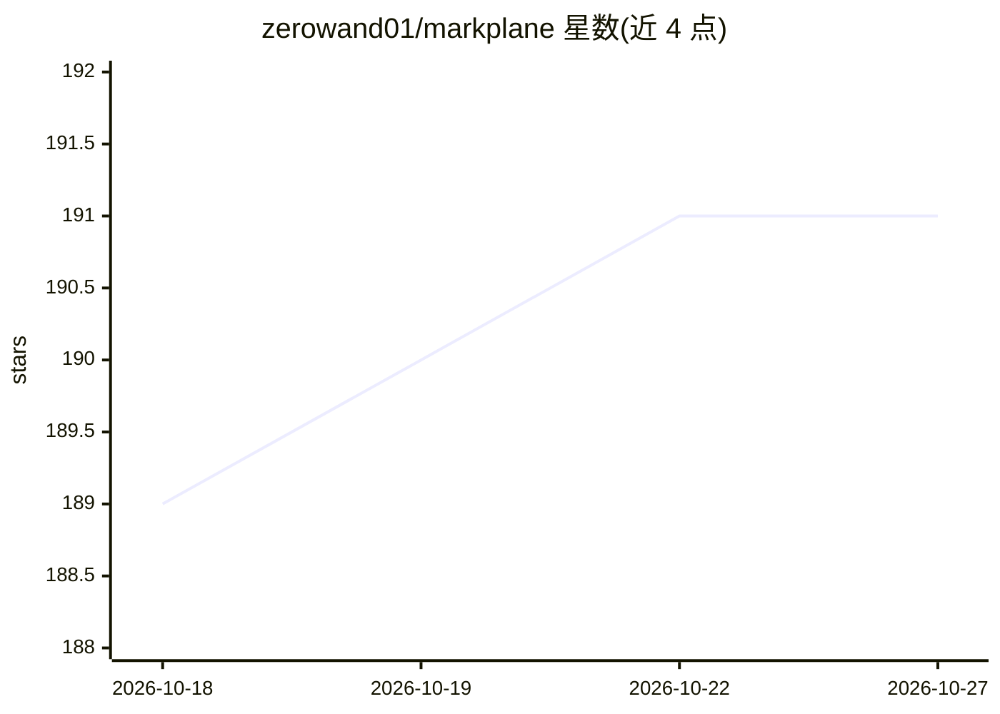

# zerowand01/markplane

⭐ 191 · Rust · Apache-2.0 · 推送 2026-10-24 · [GitHub](https://github.com/zerowand01/markplane) · 个人维护

**仓库内 Markdown 项目管理工具，为 AI 编程助手提供项目上下文**

单二进制的项目管理工具：将任务、epic、计划以 Markdown + YAML frontmatter 文件存储在代码仓库内，随 git 版本化。核心机制是自动生成的 .context/ 目录，将完整项目状态压缩为约 1000 token 的摘要，供 AI 编程助手按需加载；内置 MCP server（JSON-RPC over stdio），让 Claude Code、Cursor 等助手直接查询与更新项目。另提供 CLI、本地 Web UI（看板/依赖图）、可配置状态工作流。面向使用 AI 编程助手的开发者，无数据库、无 SaaS。

## 筛选速览

| 维度 | 判定 | 备注 |
|---|---|---|
| AI 角色 | `ai-ecosystem` | LLM/agent 周边工具 |
| 许可风险 | `permissive` | Apache-2.0 |
| 部署形态 | `desktop` | 安装包/桌面程序 |
| 模型依赖 | — | README 未给出锁定关系 |
| 硬件要求 | — | 无带数字的原话,不猜 |
| 安装摩擦 | `low` | 无编译、无系统依赖或容器化 |
| 成熟度 | — | 结构信号不足 |

## 能力要点

- 项目状态压缩为 ~1000 token 的 .context/ 摘要，含 INDEX.md 按需加载路由
- 内置 MCP server，AI 助手可直接创建任务、更新状态、追踪依赖
- 任务/epic/计划/笔记以 Markdown + YAML frontmatter 存于仓库，git 版本化
- CLI、本地 Web UI（看板、依赖图）与 MCP/文件编辑实时同步（WebSocket）

## 适用场景

- 让 Claude Code / Cursor 等 AI 助手理解并管理我仓库里的任务与计划
- 把项目状态作为自主 agent 的跨会话结构化记忆
- 在编辑器和对话流内完成项目管理，不切换到外部 SaaS 工具

## 场景标签

`Agent 记忆` · 领域:Agent 开发

## 证据(README 行号)

> L11: Markplane stores every task, epic, and plan as a markdown file inside your repo — version-controlled with git, brow
> L33: - **AI-native, not AI-retrofitted** — `.context/` summaries compress full project state into ~1000 tokens. Your AI 

## 星数曲线

2026-10-18 189 → 2026-10-27 191（+2）

---
*卡片 v1 · prompt 1.4 · 生成 2026-10-22 · 置信度 high · 依据 README sha `da0c6dd54ada` · [字段定义](../../DATASET.md)*
