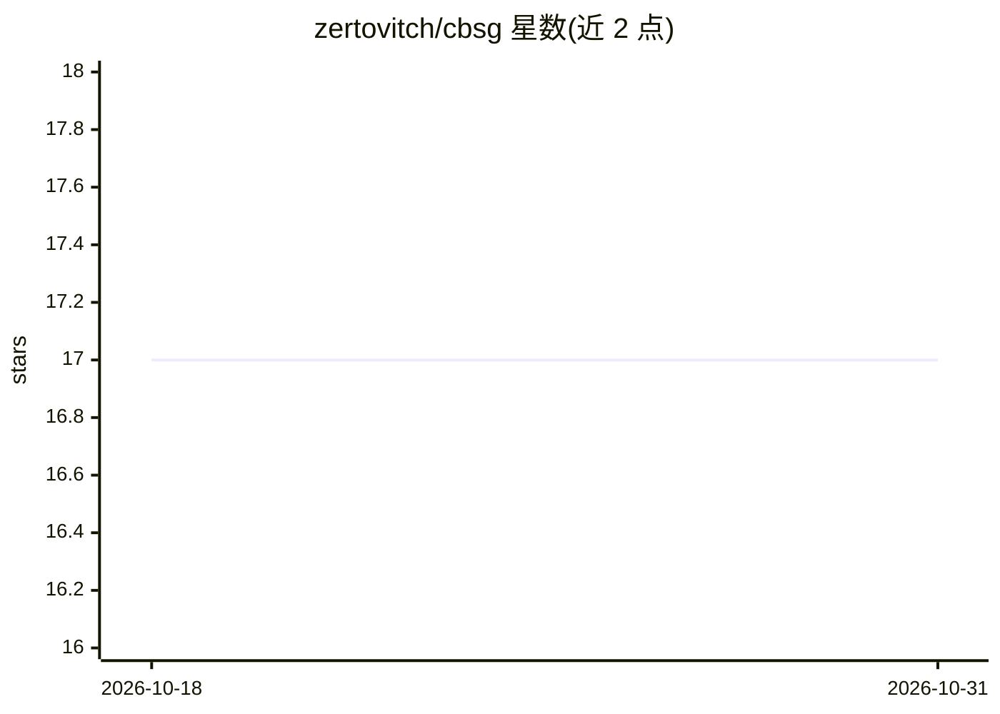

# zertovitch/cbsg

⭐ 17 · Ada · 推送 2026-06-28 · [GitHub](https://github.com/zertovitch/cbsg) · [官网](https://tinyurl.com/y3d6wyd6) · 个人维护

**Ada 编写的随机企业黑话生成器**

用 Ada 实现的随机文本生成器，基于 1700+ 词汇与结构随机组合产出企业风格语句，号称每秒可生成 1000 页 A4 文本；附带随机老板头衔生成器，其底层 Delirium 随机英语语法框架可复用于其他文本生成器。注意它是基于语法模板的随机拼接，非模型推理。通过 Alire（alr get cbsg）或自行用 GNAT 等 Ada 编译器（gprbuild）构建运行，输出可执行文件。面向寻求趣味文本或 Ada 语法框架示例的用户。

## 筛选速览

| 维度 | 判定 | 备注 |
|---|---|---|
| AI 角色 | `ai-native` | 本体是模型或模型工具 |
| 许可风险 | `none` | — |
| 部署形态 | `desktop` | 安装包/桌面程序 |
| 模型依赖 | — | README 未给出锁定关系 |
| 硬件要求 | — | 无带数字的原话,不猜 |
| 安装摩擦 | `low` | 无编译、无系统依赖或容器化 |
| 成熟度 | — | 结构信号不足 |

## 能力要点

- 1700+ 词汇与结构，上下文敏感的随机拼接生成
- 随机企业老板头衔生成器
- Delirium 随机英语语法框架可复用于其他文本生成器

## 适用场景

- 生成企业风格讽刺文本用于演示或娱乐
- 参考 Delirium 框架编写自己的随机文本生成器
- 作为 Ada/Alire 项目的示例练习

## 场景标签

 · 领域:娱乐/文本生成

## 证据(README 行号)

> L6:  The Corporate Bullshit Generator is a high-performance random text generator
> L17:  * the Delirium random English grammar framework can be used for various text generators

## 星数曲线

2026-10-18 17 → 2026-10-31 17（+0）

---
*卡片 v1 · prompt 1.4 · 生成 2026-10-29 · 置信度 mid · 依据 README sha `dd8ed0b068f5` · [字段定义](../../DATASET.md)*
