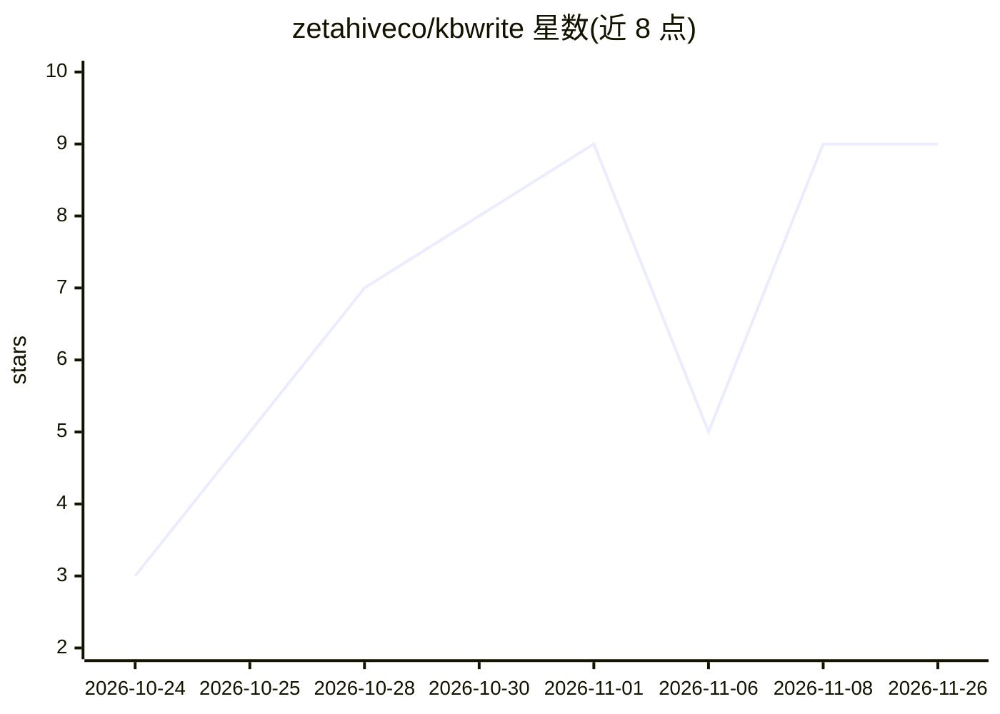

# zetahiveco/kbwrite

⭐ 9 · TypeScript · MIT · 推送 2026-10-27 · [GitHub](https://github.com/zetahiveco/kbwrite) · [官网](https://kbwrite.ink) · 个人维护

**本地优先的开源笔记知识库，支持 MCP 让 AI 读写笔记库**

基于 Tauri + React + BlockNote 构建的本地优先知识库，笔记以纯 markdown 文件形式存放在用户指定的磁盘文件夹中。功能包括块编辑器、数学公式（KaTeX）、Mermaid 图表、代码高亮、双链（wikilinks）、全局搜索、关系图视图、Prettier 自动格式化与 Rust 插件扩展。内置 MCP 服务器，可在设置中启动并监听 127.0.0.1:47321，使 Claude、Codex 或 OpenCode 能读写笔记库。macOS/Linux/Windows 提供一键安装脚本，也可从源码构建。

## 筛选速览

| 维度 | 判定 | 备注 |
|---|---|---|
| AI 角色 | `ai-enhanced` | 去掉 AI 部分产品仍成立 |
| 许可风险 | `permissive` | MIT |
| 部署形态 | `library` | 以包/库形式分发 |
| 模型依赖 | — | README 未给出锁定关系 |
| 硬件要求 | — | 无带数字的原话,不猜 |
| 安装摩擦 | `low` | 无编译、无系统依赖或容器化 |
| 成熟度 | — | 结构信号不足 |

## 能力要点

- 笔记以纯 markdown 文件存储于本地文件夹，可移植、可 diff
- MCP 服务器支持连接 Claude、Codex、OpenCode 读写笔记库
- Rust 插件系统，可从文件夹或 GitHub URL 安装扩展
- 块编辑器支持嵌入 PDF、CSV、DOCX、XLSX 等文件类型

## 适用场景

- 在本地文件夹中管理 markdown 笔记并保持文件可备份可同步
- 让 Claude 等 AI 客户端通过 MCP 读取和写入个人笔记库
- 用双链和关系图视图组织个人知识网络

## 场景标签

`知识库管理` · 领域:知识与检索

## 证据(README 行号)

> L3: A local-first, Obsidian-style knowledge base. The interface is React, the block editor is BlockNote, and the desktop
> L24: - **MCP server** — start it in Settings, then connect Claude, Codex, or OpenCode so they can read and write the vau

## 星数曲线

2026-10-24 3 → 2026-11-26 9（+6）

---
*卡片 v1 · prompt 1.4 · 生成 2026-11-20 · 置信度 high · 依据 README sha `cf99a57e23aa` · [字段定义](../../DATASET.md)*
