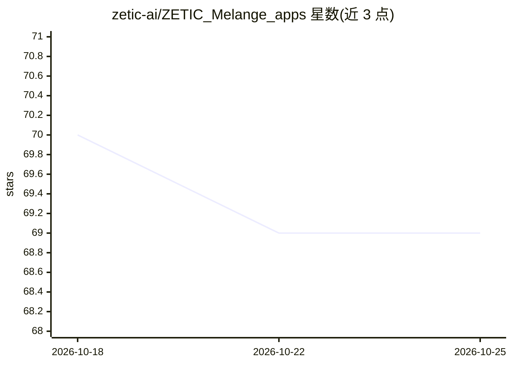

# zetic-ai/ZETIC_Melange_apps

⭐ 69 · Swift · Apache-2.0 · 推送 2026-08-25 · [GitHub](https://github.com/zetic-ai/ZETIC_Melange_apps) · [官网](https://mlange.zetic.ai) · 组织维护

**基于 Melange 的端侧 NPU AI 移动应用示例集合（已冻结迁移）**

ZETIC 维护的端侧 AI 应用源码集合：提供 20 余个在 Android/iOS 上本地运行、经 NPU 加速的应用（对话、翻译、语音识别、目标检测、心率测量、皮肤分类等），每个应用含 Kotlin 与 Swift 工程、模型准备脚本和文档。模型经 Melange 平台自动转换为移动 SDK，运行需免费 Melange Personal Access Token；Melange SDK 为专有库。注意：仓库已声明冻结并停止维护，全部内容迁移至 awesome-on-device-ai-apps 新仓库。

## 筛选速览

| 维度 | 判定 | 备注 |
|---|---|---|
| AI 角色 | `ai-native` | 本体是模型或模型工具 |
| 许可风险 | `permissive` | Apache-2.0 |
| 部署形态 | `None` |  |
| 模型依赖 | — | README 未给出锁定关系 |
| 硬件要求 | — | 无带数字的原话,不猜 |
| 安装摩擦 | `low` | 无编译、无系统依赖或容器化 |
| 成熟度 | — | 结构信号不足 |

## 能力要点

- 20+ 个 Android/iOS 双平台端侧 AI 应用完整工程（Apache 2.0）
- 覆盖 LLM 对话、翻译、ASR、目标检测、人脸、rPPG 心率、医疗影像等用例
- 通过 Melange 平台自动做模型优化与 NPU 加速转换
- 提供 Gradle / Swift Package Manager 方式接入 Melange SDK 的集成代码

## 适用场景

- 参考完整工程学习端侧 NPU 推理应用的实现模式
- 获取离线翻译、AI 键盘等可部署的移动 AI 应用源码
- 把自己的模型经 Melange 转换后嵌入自有 App

## 场景标签

`语音识别` `目标检测` `人脸识别` · 领域:感知与多模态

## 证据(README 行号)

> L48: Welcome to the collection of **open-source, on-device AI applications** built with **Melange**. These are not just 
> L97: |**Conversational AI**|**Qwen3Chat**|On-device large language model chatbot with real-time token streaming and dyna

## 星数曲线

2026-10-18 70 → 2026-10-25 69（-1）

---
*卡片 v1 · prompt 1.4 · 生成 2026-10-24 · 置信度 high · 依据 README sha `ae900df2db0e` · [字段定义](../../DATASET.md)*
