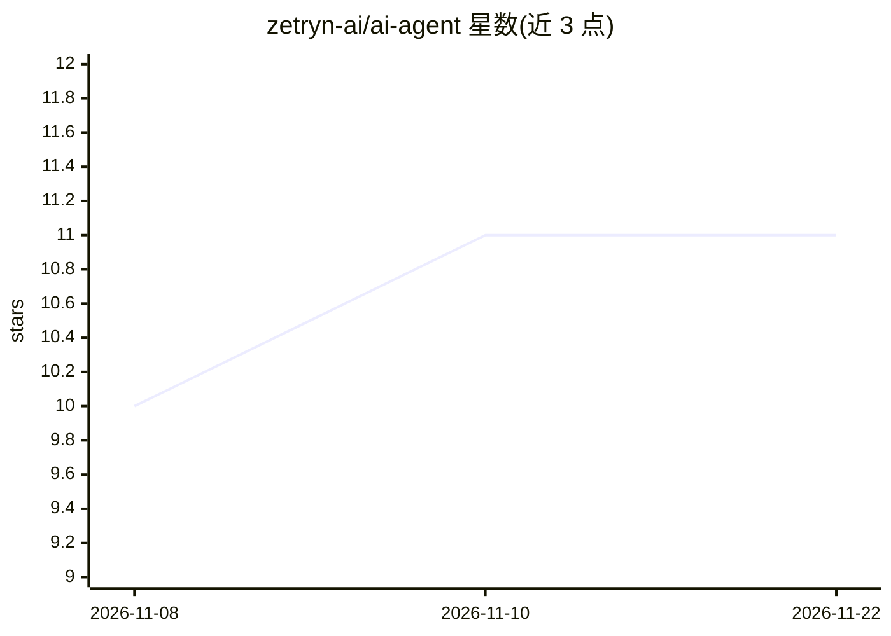

# zetryn-ai/ai-agent

⭐ 11 · HTML · MIT · 推送 2026-07-15 · [GitHub](https://github.com/zetryn-ai/ai-agent) · 组织维护

**Solana memecoin 交易决策引擎：LLM 图编排产出可审计决策**

Python 框架，将机器人推送的 Solana memecoin 数据经安全/情报/市场门与 LLM 分析员图处理后返回结构化 Decision，框架只决策不执行、不持有私钥、不上链。核心含图引擎、7 提供商 LLM 路由（429 轮换与限流）、知识/技能/记忆层、8 个参考代理、YAML 声明式图加载、回测与逐步追踪。限制：托管平台与订阅模式尚未上线，现需自备公共 LLM 提供商 key。

## 筛选速览

| 维度 | 判定 | 备注 |
|---|---|---|
| AI 角色 | `ai-ecosystem` | LLM/agent 周边工具 |
| 许可风险 | `permissive` | MIT |
| 部署形态 | `library` | 以包/库形式分发 |
| 模型依赖 | locked-api |  |
| 硬件要求 | — | 无带数字的原话,不猜 |
| 安装摩擦 | `low` | 无编译、无系统依赖或容器化 |
| 成熟度 | — | 结构信号不足 |

## 能力要点

- 8 个参考代理共享统一契约：bot 填上下文，框架返回 Decision
- LLMRouter 支持 7 提供商、key 轮换与按模型限流
- 每节点生成 StepTrace，决策可记录到 DecisionLog 并回测重放
- YAML 声明式图定义，AST 白名单校验、运行时不用 eval

## 适用场景

- 为自己的 memecoin 机器人接入决策引擎，执行与决策分离
- 用 hybrid_audit 模式在低延迟规则路径上异步获得 LLM 复核
- 对交易决策做逐节点追踪与事后复盘
- 用 YAML 配置简单策略而无需 Python 接线

## 场景标签

`Agent 框架` `金融量化` · 领域:Agent 开发

## 证据(README 行号)

> L9: A Python framework that turns raw Solana memecoin data into structured,
> L99: |**LLM router**|7 providers (Groq, Gemini, OpenRouter, Cerebras, Mistral, SambaNova, NVIDIA NIM), key rotation on 4

## 星数曲线

2026-11-08 10 → 2026-11-22 11（+1）

---
*卡片 v1 · prompt 1.4 · 生成 2026-11-18 · 置信度 high · 依据 README sha `ef7b7f791f96` · [字段定义](../../DATASET.md)*
