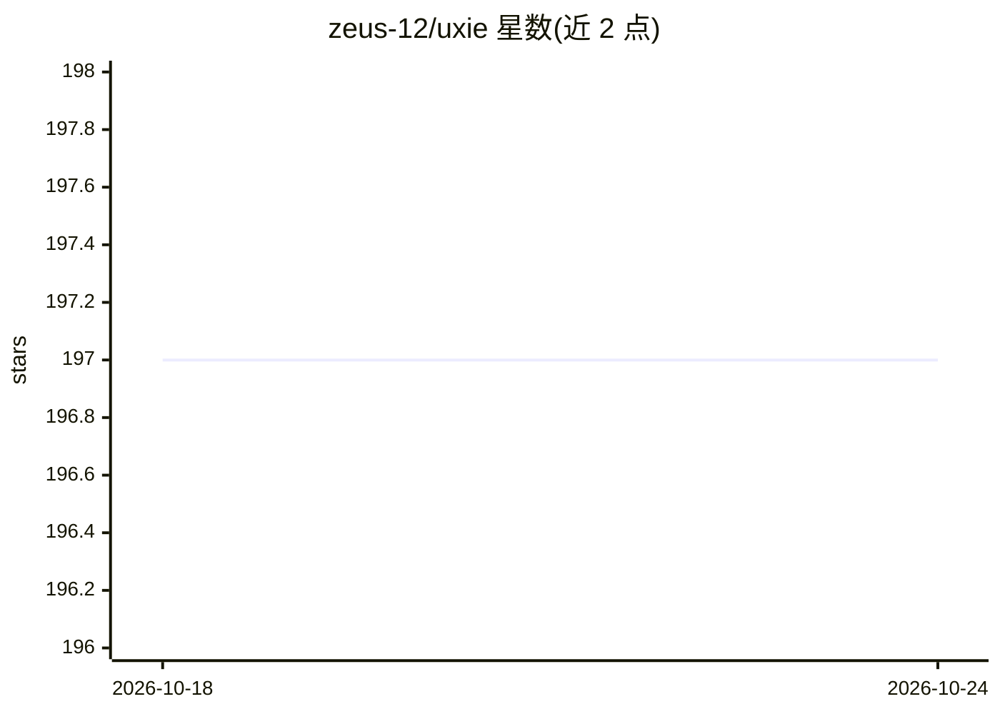

# zeus-12/uxie

⭐ 196 · TypeScript · 推送 2026-09-19 · [GitHub](https://github.com/zeus-12/uxie) · [官网](https://uxie.vercel.app) · 个人维护

**带 AI 对话与闪卡功能的 PDF 阅读笔记应用（Web + 桌面）**

同一代码库构建两个应用：托管 Web 版（Next.js + Supabase/Pinecone/Liveblocks/Gemini）与本地优先的 Electron 桌面版（SQLite/sqlite-vec/transformers.js 本地嵌入，LLM 可指向任意 OpenAI 兼容端点）。功能覆盖 PDF 高亮标注、块式笔记与 AI 补全、RAG 问答、AI 评估答案的闪卡、TTS、OCR 与阅读模式。桌面版仅 macOS arm64，发布无签名 DMG。

## 筛选速览

| 维度 | 判定 | 备注 |
|---|---|---|
| AI 角色 | `ai-enhanced` | 去掉 AI 部分产品仍成立 |
| 许可风险 | `none` | — |
| 部署形态 | `library` | 以包/库形式分发 |
| 模型依赖 | — | README 未给出锁定关系 |
| 硬件要求 | — | 无带数字的原话,不猜 |
| 安装摩擦 | `low` | 无编译、无系统依赖或容器化 |
| 成熟度 | — | 结构信号不足 |

## 能力要点

- 一套代码同时构建 Web 与本地优先桌面应用
- 桌面版嵌入模型本地运行（transformers.js，q8 量化），数据不出本机
- RAG 文档问答、AI 评估闪卡、AI 笔记补全
- PDF 高亮标注与笔记互链、逐句高亮 TTS

## 适用场景

- 阅读 PDF 时做标注与结构化笔记并导出 markdown
- 向文档提问生成摘要、用闪卡复习并获得 AI 反馈
- 本地离线环境（macOS）中保管文档且推理不出本机

## 场景标签

`文档问答` `知识库管理` `语音合成` `OCR` · 领域:内容生成

## 证据(README 行号)

> L37: - Highlight and annotate PDFs; highlights link back into your notes and jump to the page on click
> L39: - Summarise and ask questions about a PDF (RAG, with tool-calling on desktop)
> L40: - Flashcards with AI evaluation of your answers

## 星数曲线

2026-10-18 197 → 2026-10-24 197（+0）

---
*卡片 v1 · prompt 1.4 · 生成 2026-10-22 · 置信度 mid · 依据 README sha `7f8caca65efc` · [字段定义](../../DATASET.md)*
