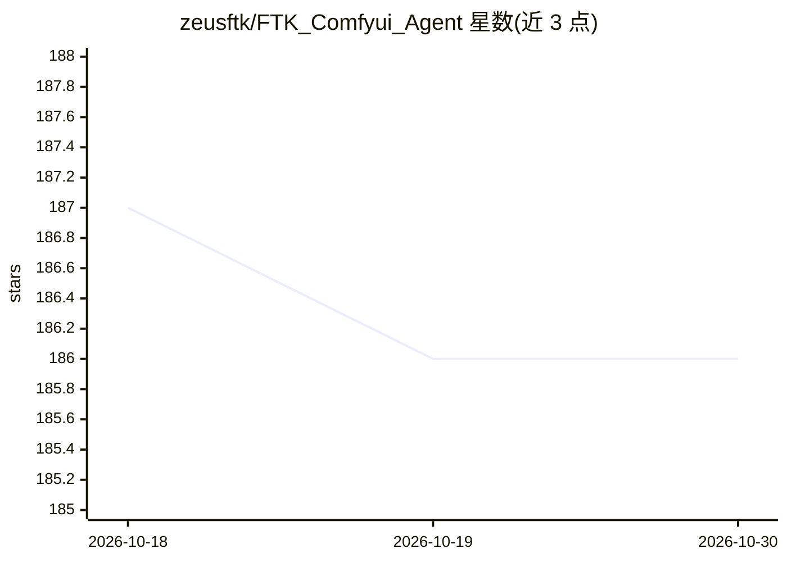

# zeusftk/FTK_Comfyui_Agent

⭐ 186 · Python · 推送 2026-02-10 · [GitHub](https://github.com/zeusftk/FTK_Comfyui_Agent) · 个人维护 · 中文 README

**对话调用 ComfyUI 的多媒体生成桌面工具：文/图生视频、换脸、配音**

Windows 桌面应用，通过自然语言对话调用并执行 ComfyUI 工作流，覆盖文生图、图生视频、视频重绘、换脸/换头/换装、口播与播客生成、配乐配音等 30 余种内置功能。面向两类用户：零基础用户无需了解 ComfyUI 即可通过对话完成生成任务；工作流专家可管理、加密分发和限定工作流的使用范围。安装方式为下载一键安装包运行 exe，macOS 安装标注为 todo；图像/视频功能需下载内置模型包（评论功能可免下 200G 模型）；首次运行部分模型需编译为 TensorRT，建议 RTX3060 以上 NVIDIA 显卡。

## 筛选速览

| 维度 | 判定 | 备注 |
|---|---|---|
| AI 角色 | `ai-native` | 本体是模型或模型工具 |
| 许可风险 | `none` | — |
| 部署形态 | `desktop` | 安装包/桌面程序 |
| 模型依赖 | — | README 未给出锁定关系 |
| 硬件要求 | — | 无带数字的原话,不猜 |
| 安装摩擦 | `medium` | 含编译或系统依赖之一 |
| 成熟度 | `idea` | |

## 能力要点

- 自然语言对话自动调用 ComfyUI 工作流并自动映射参数
- 内置 30 余种图像/视频/音频生成功能（换脸、口播、图生视频、BGM 等）
- 工作流加密分发与按场景/人群限定调用范围
- 支持自定义 ComfyUI 配置使用自己的工作流

## 适用场景

- 不会 ComfyUI 的新手通过聊天直接生成图片和视频
- 自媒体内容制作：短剧、口播、Vlog、自动评论、批量发布
- 团队内分发和管理 ComfyUI 工作流给非技术成员使用

## 场景标签

`图像生成` `视频生成` `语音合成` · 领域:内容生成

## 证据(README 行号)

> L6: 该工具集成多项先进AI技术，覆盖视频、音频、剪辑全流程处理，核心能力包括 **✨ AI剪辑、AI特效、智能配音、AI自动评论** 等。其内置横竖屏分类、场景切片、动作片段提取、字幕添加、音色转换等实用功能，支持 **🚀 开箱即用零配
> L8: FTK COMFYUI Agent 核心功能：通过连接ComfyUI实现AI服务，智能管理ComfyUI工作流，实现仅靠通过对话无感调用工作流完成各种任务。
> L36: #### 🎯 零基础用户

## 星数曲线

2026-10-18 187 → 2026-10-30 186（-1）

---
*卡片 v1 · prompt 1.4 · 生成 2026-10-22 · 置信度 high · 依据 README sha `2f727461e127` · [字段定义](../../DATASET.md)*
