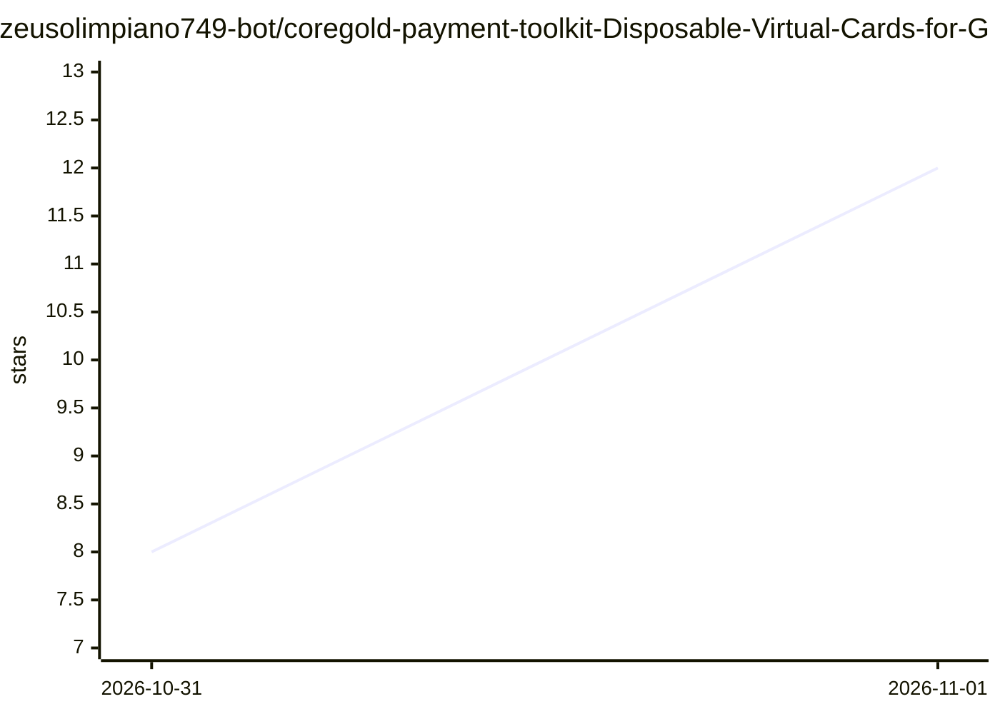

# zeusolimpiano749-bot/coregold-payment-toolkit-Disposable-Virtual-Cards-for-Global-SaaS-Ad-Spend

⭐ 12 · 推送 2026-10-30 · [GitHub](https://github.com/zeusolimpiano749-bot/coregold-payment-toolkit-Disposable-Virtual-Cards-for-Global-SaaS-Ad-Spend) · [官网](https://app.coregold.io/signup?invite_code=ADvlj9b) · 个人维护 · 中文 README

**CoreGold 海外虚拟卡服务的推广页：USDT 充值按需开卡付海外订阅**

该仓库为 CoreGold 虚拟卡发卡服务的推广介绍页，非软件代码项目：用户在官方后台以 USDT 充值换取美元余额，按需生成带独立限额的 Visa/Mastercard 商业卡，卡号、CVV、到期日与英文 AVS 地址可复制到海外服务结算页绑定，用后注销回收余额。面向需订阅 AI 工具、云服务与海外广告投放但不愿绑定真实信用卡的用户。仓库内仅含营销文案与注册入口，无可安装运行的程序，末尾附疑似推广追踪哈希。

## 筛选速览

| 维度 | 判定 | 备注 |
|---|---|---|
| AI 角色 | `ai-enhanced` | 去掉 AI 部分产品仍成立 |
| 许可风险 | `none` | — |
| 部署形态 | `None` |  |
| 模型依赖 | — | README 未给出锁定关系 |
| 硬件要求 | — | 无带数字的原话,不猜 |
| 安装摩擦 | `low` | 无编译、无系统依赖或容器化 |
| 成熟度 | — | 结构信号不足 |

## 能力要点

- USDT 链上充值并按需生成带限额的虚拟 Visa/Mastercard
- 生成卡号、CVV、到期日与配套英文 AVS 账单地址
- 注销卡片后余额回退母账户
- 一号一卡的账号支付隔离

## 适用场景

- 订阅 OpenAI、Claude 等海外 AI 工具而不绑真实信用卡
- 海外云服务与广告账单的限额支付
- 多账号业务的支付信息隔离

## 场景标签

 · 领域:跨境支付服务

## 证据(README 行号)

> L6: > 使用 **CoreGold**，直接在后台为每个海外服务生成一张**独立限额的 Visa / Mastercard 商业卡**。USDT 充值，花多少设多少，用完即销，把支付主动权握在自己手里。
> L26: * **账户入金**：后台通过 USDT 链上充值，全自动到账转化为美元可用余额。
> L27: * **按需生成**：选择对标业务的卡段类型，填入消费限额，即刻提取完整卡号、CVV、到期日与配套英文地址。

## 星数曲线

2026-10-31 8 → 2026-11-01 12（+4）

---
*卡片 v1 · prompt 1.4 · 生成 2026-10-31 · 置信度 mid · 依据 README sha `a943deb7396e` · [字段定义](../../DATASET.md)*
