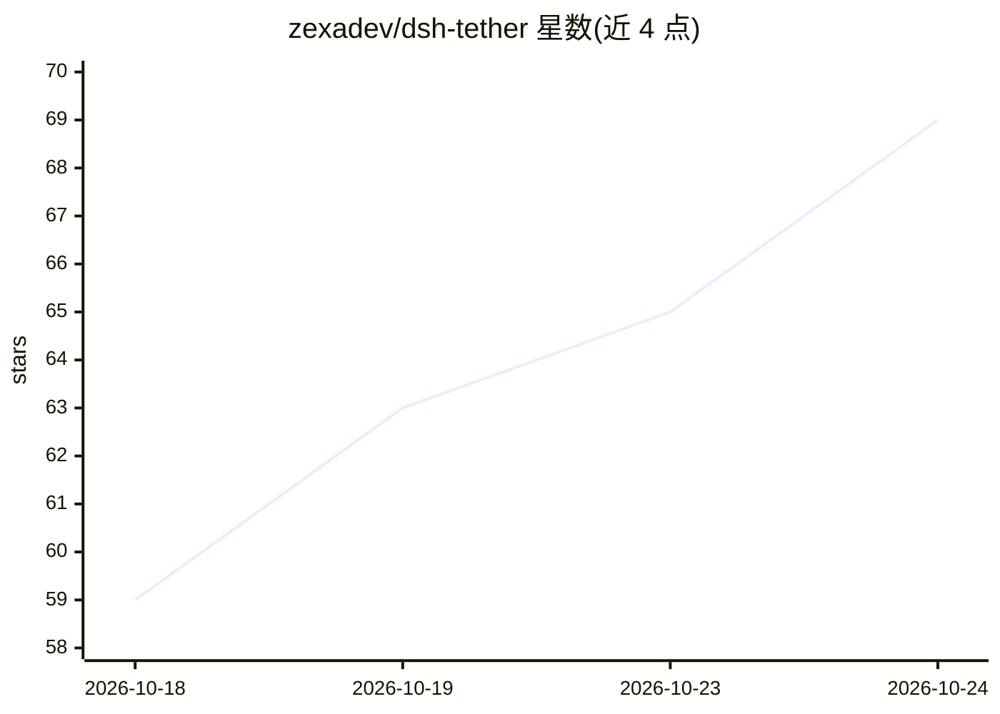

# zexadev/dsh-tether

⭐ 76 · JavaScript · MIT · 推送 2026-10-24 · [GitHub](https://github.com/zexadev/dsh-tether) · [官网](https://dsh-tether.zexa.cc/) · 个人维护 · 中文 README

**手机远程使用 DeepSeek Harness 的 P2P 客户端（dsh 插件）**

由 dsh 插件与手机 App 组成的社区项目：插件侧在开发机上通过 iroh 打洞建立端到端加密的点对点连接（失败时回落到只见密文的 relay），手机端呈现 DSH 自带的 Web 界面（会话、工具调用、审批、设置），配对一次后跨网络自动连接；也可管理多台已配对机器并推送审批通知。Android 端另有 Local 模式，将 dsh 0.2.1-rc.2 连同 Node 24 运行时打包进 APK 在手机本地运行；iOS 版为未签名 beta，仅 CI 构建未在真机验证。README 明确与 DeepSeek 无隶属关系。

## 筛选速览

| 维度 | 判定 | 备注 |
|---|---|---|
| AI 角色 | `ai-ecosystem` | LLM/agent 周边工具 |
| 许可风险 | `permissive` | MIT |
| 部署形态 | `library` | 以包/库形式分发 |
| 模型依赖 | locked-api |  |
| 硬件要求 | — | 无带数字的原话,不猜 |
| 安装摩擦 | `high` | 编译与系统依赖俱全 |
| 成熟度 | `idea` | |

## 能力要点

- iroh 打洞直连 + 只见密文的 relay 回落，端到端加密
- 呈现 DSH 自带完整界面，含审批通知与多机器管理
- Android Local 模式：APK 内置 Node 24 与 dsh 0.2.1-rc.2，免 Termux 本地运行
- 6 位 CSPRNG 配对码（10 分钟有效）+ iroh 公钥认证

## 适用场景

- 人不在开发机网络内时，用手机跨网络操作开发机上的 DSH agent
- 在没有电脑的场合直接在 Android 手机上运行 DeepSeek Harness
- 随时审批开发机上等待确认的 agent 操作

## 场景标签

`编码 Agent` · 领域:编码与开发

## 证据(README 行号)

> L25: DSH Tether carries the DeepSeek Harness web interface to your phone over a direct peer-to-peer connection. The agen
> L52: |Machine|—|`dsh plugin --profile web add dsh-plugin-tether`|
> L53: |Phone|`dsh-tether-<version>-arm64.apk` from the Release|Signed — install it directly; local mode included|

## 星数曲线

2026-10-18 59 → 2026-10-24 69（+10）

---
*卡片 v1 · prompt 1.4 · 生成 2026-10-24 · 置信度 mid · 依据 README sha `0cca792f26fa` · [字段定义](../../DATASET.md)*
