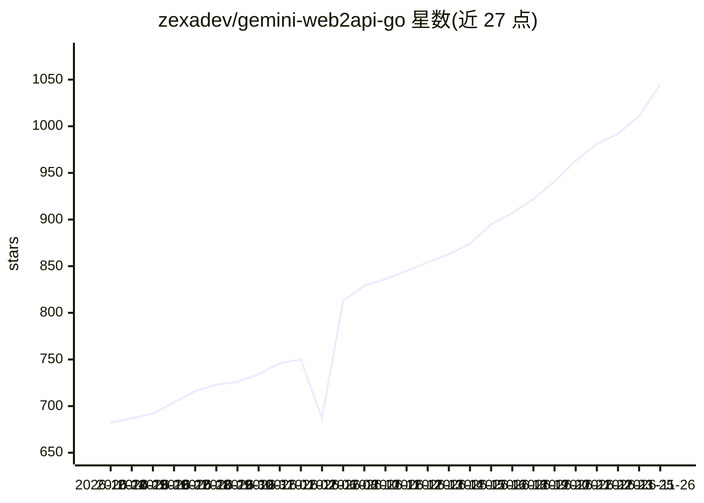

# zexadev/gemini-web2api-go

⭐ 1,045 · Go · MIT · 推送 2026-11-25 · [GitHub](https://github.com/zexadev/gemini-web2api-go) · 个人维护 · 中文 README

**把 Gemini 网页端反代成 OpenAI 兼容 API 的自托管网关**

用 Go 编写的自托管代理，逆向 gemini.google.com 网页协议，将其暴露为 /v1/chat/completions 等 OpenAI 兼容接口、Gemini 原生 /v1beta 接口和 MCP 工具，不需要 Google API key。关键机制：Chrome TLS 指纹模拟、多账号 cookie 池轮转与自动续期、代理池熔断与轮转、strict_model 防静默降级（降级回 429）、内置中文管理面板与请求元数据统计。单二进制分发，支持 SQLite/MySQL/PostgreSQL。依赖网页协议，上游模型与可用性随 Gemini 网页端变动。

## 筛选速览

| 维度 | 判定 | 备注 |
|---|---|---|
| AI 角色 | `ai-ecosystem` | LLM/agent 周边工具 |
| 许可风险 | `permissive` | MIT |
| 部署形态 | `desktop` | 安装包/桌面程序 |
| 模型依赖 | — | README 未给出锁定关系 |
| 硬件要求 | — | 无带数字的原话,不猜 |
| 安装摩擦 | `low` | 无编译、无系统依赖或容器化 |
| 成熟度 | — | 结构信号不足 |

## 能力要点

- OpenAI 兼容 + Gemini 原生 + /v1/videos 视频生成三套接口同端口提供
- Cookie 池轮转、自动续期，代理池熔断与独立限流槽
- strict_model 防静默降级：降级回答不算成功，全池降级回 429
- 内置中文管理面板与 MCP server（搜索/生图/音乐/视频工具）

## 适用场景

- 让只支持 OpenAI 兼容接口的客户端接入 Gemini 网页端模型
- 在 newapi/one-api 里新建渠道统一管理多个 Google 账号额度
- 给 Claude Desktop/Cursor 通过 MCP 调用联网搜索、生图、视频生成

## 场景标签

`模型网关` `视频生成` · 领域:Agent 开发

## 证据(README 行号)

> L3: **Gemini web → OpenAI-compatible API.** A self-hosted proxy that turns the free gemini.google.com web app into `/v1/
> L18: 把 Google Gemini 网页端反代成 OpenAI 兼容 API，同一端口还提供 Gemini 原生接口和 MCP 工具。**单二进制**，**零账号**（匿名可跑），**Chrome 146 真指纹**，**SQLite
> L33: 不是 Google 官方 API（generativelanguage.googleapis.com）的二次封装——**直接反代浏览器协议**，所以**不需要 Google API Key、不需要付费配额**。

## 星数曲线

2026-10-24 682 → 2026-11-26 1,045（+363）

---
*卡片 v1 · prompt 1.4 · 生成 2026-11-26 · 置信度 high · 依据 README sha `e3c57dcc7fe1` · [字段定义](../../DATASET.md)*
