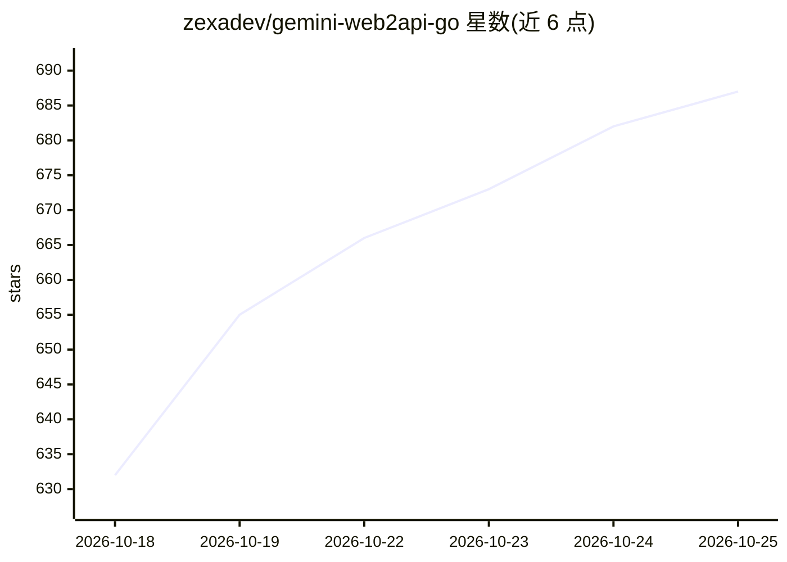

# zexadev/gemini-web2api-go

⭐ 692 · Go · MIT · 推送 2026-10-24 · [GitHub](https://github.com/zexadev/gemini-web2api-go) · 个人维护 · 中文 README

**自托管代理：把 Gemini 网页端反代成 OpenAI 兼容 API**

用 Go 编写的单二进制代理服务，逆向 gemini.google.com 网页协议，对外暴露 /v1/chat/completions 等 OpenAI 兼容接口，无需 Google API key。机制上用 utls 模拟 Chrome 146 TLS 指纹，提供 cookie 池自动续期、代理池轮转与按出口 IP 三档限流；支持匿名调用两档文本模型，挂 Google cookie 后解锁 Pro 模型、扩展思考、读图、生图/音乐/画布/生视频。内置中文管理面板，SQLite/MySQL/PostgreSQL 持久化，prompt 与回复内容不入库。同一进程还挂 MCP server 暴露 web_search 工具。限制：多轮上下文靠拼接 prompt，匿名约 13 万字节、挂 cookie 约 16 万字节后仍需客户端自行压缩；深度研究未实现。

## 筛选速览

| 维度 | 判定 | 备注 |
|---|---|---|
| AI 角色 | `ai-ecosystem` | LLM/agent 周边工具 |
| 许可风险 | `permissive` | MIT |
| 部署形态 | `desktop` | 安装包/桌面程序 |
| 模型依赖 | — | README 未给出锁定关系 |
| 硬件要求 | — | 无带数字的原话,不猜 |
| 安装摩擦 | `low` | 无编译、无系统依赖或容器化 |
| 成熟度 | — | 结构信号不足 |

## 能力要点

- 逆向 Gemini 网页协议输出 /v1/chat/completions 等 OpenAI 兼容接口，无需 API key
- utls 模拟 Chrome 146 TLS 指纹 + cookie 池自动续期 + 代理池轮转 + 按出口 IP 限流
- 支持生图（Nano Banana）、音乐（Lyria）、画布与异步视频生成（/v1/videos）
- 内置中文管理面板，SQLite/MySQL/PG 存储，prompt 与回复内容永不入库
- 同进程 MCP server 把 Gemini 联网搜索暴露为 web_search 工具

## 适用场景

- 让 Cherry Studio / ChatBox / Cursor 等 OpenAI 兼容客户端直接调用 Gemini 网页端
- 在 newapi / one-api 中添加 OpenAI 类型渠道接入此代理
- 通过 Claude Desktop / Claude Code 等 MCP 客户端使用 Gemini 联网搜索工具
- 自托管零 API key 的 LLM 网关并管理多账号 cookie 与代理池

## 场景标签

`模型网关` · 领域:Agent 开发

## 证据(README 行号)

> L3: **Gemini web → OpenAI-compatible API.** A self-hosted proxy that turns the free gemini.google.com web app into `/v1/
> L27:     ↓ 逆向 gemini.google.com 网页协议

## 星数曲线

2026-10-18 632 → 2026-10-25 687（+55）

---
*卡片 v1 · prompt 1.4 · 生成 2026-10-21 · 置信度 high · 依据 README sha `4be47e7d78f1` · [字段定义](../../DATASET.md)*
