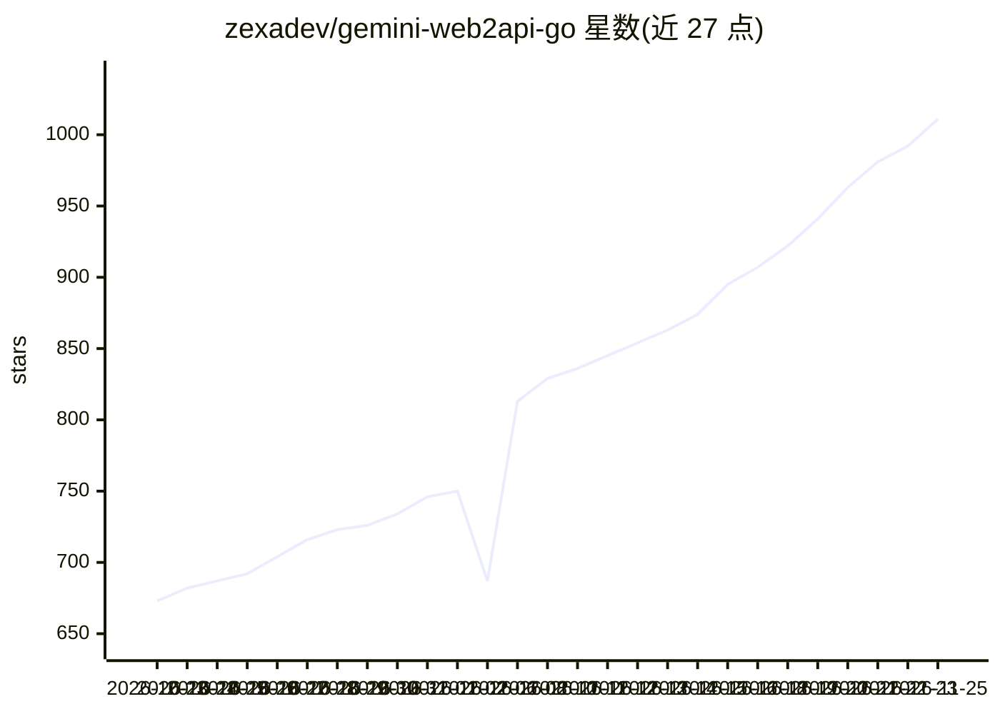

# zexadev/gemini-web2api-go

⭐ 1,011 · Go · MIT · 推送 2026-11-23 · [GitHub](https://github.com/zexadev/gemini-web2api-go) · 个人维护 · 中文 README

**把 Gemini 网页端反代成 OpenAI 兼容 API 的自托管 Go 服务**

自托管代理服务：逆向 gemini.google.com 网页协议，对外提供 OpenAI 兼容接口、Gemini 原生接口和 MCP 工具，不需要 Google API key。关键机制包括 utls 模拟 Chrome 146 TLS 指纹、多账号 Cookie 池自动续期与轮转、代理池熔断调度、strict_model 降级返回 429。单 Go 二进制交付，支持 Docker 与源码构建，内置中文管理面板，持久化默认 SQLite，可选 MySQL/PostgreSQL；prompt 与回复内容不写库，只存元数据。需要 Google 账号 cookie 才能使用部分模型与图片/视频功能。

## 筛选速览

| 维度 | 判定 | 备注 |
|---|---|---|
| AI 角色 | `ai-ecosystem` | LLM/agent 周边工具 |
| 许可风险 | `permissive` | MIT |
| 部署形态 | `desktop` | 安装包/桌面程序 |
| 模型依赖 | — | README 未给出锁定关系 |
| 硬件要求 | — | 无带数字的原话,不猜 |
| 安装摩擦 | `low` | 无编译、无系统依赖或容器化 |
| 成熟度 | — | 结构信号不足 |

## 能力要点

- OpenAI 兼容 + Gemini 原生 + /v1/videos 视频生成三套接口同一端口提供
- Cookie 池最久未用优先轮转、自动续期，代理池熔断与独立限流
- strict_model 模式：静默降级不算成功，全池降级回 429
- 内置中文管理面板，前端单 HTML 不走 CDN，支持离线部署

## 适用场景

- 给 Cherry Studio / ChatBox / dify 等 OpenAI 兼容客户端接入 Gemini 网页端
- 通过 newapi/one-api 建渠道聚合使用
- 在 Claude Desktop / Claude Code 中以 MCP 工具调用联网搜索、生图、视频生成

## 场景标签

`模型网关` `视频生成` `图像生成` · 领域:Agent 开发

## 证据(README 行号)

> L3: **Gemini web → OpenAI-compatible API.** A self-hosted proxy that turns the free gemini.google.com web app into `/v1/
> L18: 把 Google Gemini 网页端反代成 OpenAI 兼容 API，同一端口还提供 Gemini 原生接口和 MCP 工具。**单二进制**，**零账号**（匿名可跑），**Chrome 146 真指纹**，**SQLite
> L238: 除了 OpenAI 接口，同一个进程、同一个端口还挂了一个 **MCP server**，在 `/mcp` 上，

## 星数曲线

2026-10-23 673 → 2026-11-25 1,011（+338）

---
*卡片 v1 · prompt 1.4 · 生成 2026-11-24 · 置信度 high · 依据 README sha `b9394a9772ef` · [字段定义](../../DATASET.md)*
