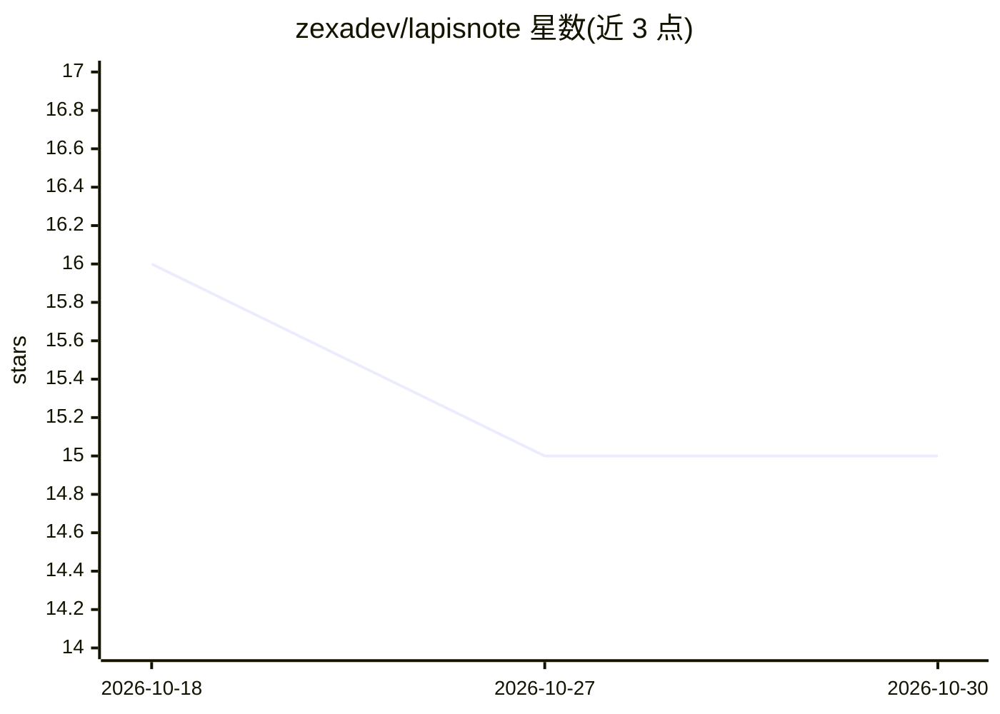

# zexadev/lapisnote

⭐ 15 · TypeScript · AGPL-3.0 · 推送 2026-09-16 · [GitHub](https://github.com/zexadev/lapisnote) · [官网](https://jdnotes.zexa.cc/) · 个人维护 · 中文 README

**带 AI 助手与 MCP 集成的本地优先跨端笔记应用**

基于 Tauri 2 + React + Rust + SQLite 的本地优先笔记应用，覆盖 Windows、Android、iOS 三端同一套功能。提供富文本 Markdown 编辑、双向链接、日历与提醒、标签与数据概览面板，支持局域网 mDNS 发现与跨网 P2P 加密同步（基于 iroh）。AI 部分包括多平台助手（DeepSeek/OpenAI/Claude/Gemini/Ollama）、内联改写与侧边栏对话，并内置 HTTP MCP Server（127.0.0.1:19230）供 Claude Code、Cursor 等 AI 工具直接读写本地笔记库。2.0 起由 jdnotes 更名，AGPL-3.0 许可。

## 筛选速览

| 维度 | 判定 | 备注 |
|---|---|---|
| AI 角色 | `ai-enhanced` | 去掉 AI 部分产品仍成立 |
| 许可风险 | `viral` | AGPL-3.0 |
| 部署形态 | `desktop` | 安装包/桌面程序 |
| 模型依赖 | local-ok | 支持本地模型 |
| 硬件要求 | — | 无带数字的原话,不猜 |
| 安装摩擦 | `low` | 无编译、无系统依赖或容器化 |
| 成熟度 | — | 结构信号不足 |

## 能力要点

- 内置 MCP Server 提供 6 个读写工具，自动注册到 Claude Code 等 9 个 AI 工具
- 局域网 mDNS 自动发现 + 跨网 P2P 加密直连多设备同步，无中心服务器
- 本地 SQLite 存储，断网可用，安装包约 8MB
- 多平台 AI 助手：DeepSeek / OpenAI / Claude / Gemini / Ollama，可同时配置多来源

## 适用场景

- 本地记录与管理 Markdown 笔记，数据不出本机
- 让 Claude Code 等 AI 编程工具直接读写我的笔记库
- 电脑与手机之间免费加密同步笔记
- 选中文本让 AI 就地改写、续写、总结或翻译

## 场景标签

 · 领域:生产力工具/笔记

## 证据(README 行号)

> L31: **Lapis** 是一款本地优先的笔记应用（Tauri 2 构建），桌面与手机同一套功能。支持局域网 + 跨网 P2P 加密多设备同步，AI 可经 MCP 直接读写你的笔记库。数据本地存储，隐私安全。
> L41: |🤖|**AI 赋能**|多平台 AI 助手，支持 DeepSeek / Claude / Gemini / Ollama|
> L39: |🔌|**AI Agent 读写**|内置 MCP Server，Claude Code / Cursor 等 AI 工具可直接在你的本地笔记库查看、创建、追加、修改笔记|

## 星数曲线

2026-10-18 16 → 2026-10-30 15（-1）

---
*卡片 v1 · prompt 1.4 · 生成 2026-10-30 · 置信度 high · 依据 README sha `552f1acdb465` · [字段定义](../../DATASET.md)*
