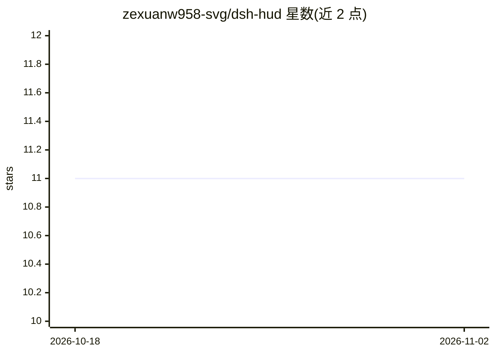

# zexuanw958-svg/dsh-hud

⭐ 11 · TypeScript · MIT · 推送 2026-08-14 · [GitHub](https://github.com/zexuanw958-svg/dsh-hud) · [官网](https://github.com/zexuanw958-svg/dsh-hud#readme) · 个人维护 · 中文 README

**DeepSeek Harness 的只读 Agent 运行态观测插件（HUD）**

面向 DeepSeek Harness Web UI 的只读观测插件：在会话标题栏常驻紧凑状态条，显示运行状态、模型路由、上下文压力、Token 用量、模型/工具耗时、后台 Jobs 与子 Agent 数量，点击可展开 Provider、Workspace 与 Session ID。数据直接消费 Harness 已有的 snapshot/projection，通过官方 conversation.session.header.actions slot 注入 React 组件，无轮询、不额外调用模型。不切换模型、不停任务、不估算费用。仅针对 Web profile 验证，绑定 DeepSeek Harness 0.1.0-rc.6，Host 处于 RC 阶段，API 变化时插件可能需跟随升级。

## 筛选速览

| 维度 | 判定 | 备注 |
|---|---|---|
| AI 角色 | `ai-ecosystem` | LLM/agent 周边工具 |
| 许可风险 | `permissive` | MIT |
| 部署形态 | `library` | 以包/库形式分发 |
| 模型依赖 | locked-api |  |
| 硬件要求 | — | 无带数字的原话,不猜 |
| 安装摩擦 | `low` | 无编译、无系统依赖或容器化 |
| 成熟度 | `idea` | |

## 能力要点

- 会话标题栏常驻状态条：运行状态、模型路由、上下文压力、步数
- 点击展开 Token 统计、模型/工具耗时、Jobs、子 Agent、Session ID
- 直接消费 Harness snapshot/projection，无轮询、零提示词上下文占用
- 复用 Harness 主题变量，支持明暗主题、键盘操作与 ARIA

## 适用场景

- 长任务中随时确认 Agent 是否仍在运行、走到第几步
- 查看上下文剩余空间与 Token 消耗，判断还能跑多久
- 掌握后台 Jobs 与子 Agent 数量，不离开当前会话

## 场景标签

`LLM 可观测性` · 领域:评测与运维

## 证据(README 行号)

> L23: `dsh-hud` 是一个面向 DeepSeek Harness Web UI 的**只读 Agent 运行态观测插件**。
> L105: - Host 侧只把已有的 `request/context` 事件折叠成只读模型路由 projection，不拦截或改写 Agent 流程；
> L106: - Client 侧订阅 Harness 已有的 session snapshot 与 projections；

## 星数曲线

2026-10-18 11 → 2026-11-02 11（+0）

---
*卡片 v1 · prompt 1.4 · 生成 2026-11-01 · 置信度 high · 依据 README sha `45a573e58955` · [字段定义](../../DATASET.md)*
