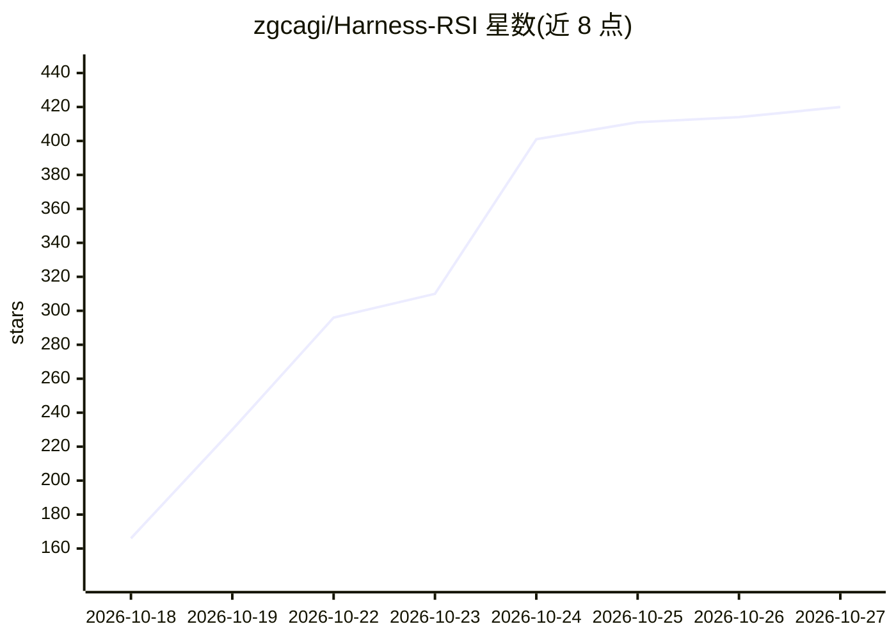

# zgcagi/Harness-RSI

⭐ 420 · TeX · CC-BY-4.0 · 推送 2026-10-23 · [GitHub](https://github.com/zgcagi/Harness-RSI) · [官网](https://zgcagi.github.io/Harness-RSI/) · 组织维护 · 中文 README

**Agent Harness 自进化综述配套文献清单：理论/方法/评测条目**

一篇 66 页综述（Harness Self-Evolution）的配套资料仓库：定义 harness 为支配模型在环境中运行的软件与配置（工具、上下文构建、记忆、执行控制），在固定基座模型前提下研究执行经验如何转化为持久的 harness 状态。内容按解释型更新（提示/记忆/技能）、可执行更新、理论、评测与应用组织，收录相关综述、先驱工作（EURISKO、Gödel Machines 等）及分小类的论文条目，每条附论文/代码/项目链接，并提供中文版阅读指南与项目主页。面向该方向的研究者选型与文献检索。

## 筛选速览

| 维度 | 判定 | 备注 |
|---|---|---|
| AI 角色 | `ai-knowledge` | 知识聚合/清单类 |
| 许可风险 | `viral` | CC-BY-4.0 |
| 部署形态 | `None` |  |
| 模型依赖 | — | README 未给出锁定关系 |
| 硬件要求 | — | 无带数字的原话,不猜 |
| 安装摩擦 | `low` | 无编译、无系统依赖或容器化 |
| 成熟度 | — | 结构信号不足 |

## 能力要点

- 给出 harness 形式化定义（Run/Update 机制）与解释型/可执行更新的分类法
- 覆盖提示优化、经验挖掘、程序性技能库、门控合并等更新机制的条目化论文清单
- 提供 66 页全文、18 页短文、中文版与项目页等配套材料

## 适用场景

- 查找 agent harness 自进化方向的论文与相关工作
- 按更新目标（提示/记忆/技能）浏览该领域方法分类
- 获取该综述的引用信息与配套分类数据

## 场景标签

`精选清单` `科研工具` · 领域:学习与行业

## 证据(README 行号)

> L13: Companion materials for our survey of how execution experience becomes persistent harness state under a fixed base 
> L27: - **A Survey of Self-Evolving Agents** `TMLR'26` — organizes self-evolution by what, when, how, and where to evolve
> L61: ## Taxonomy

## 星数曲线

2026-10-18 166 → 2026-10-27 420（+254）

---
*卡片 v1 · prompt 1.4 · 生成 2026-10-21 · 置信度 high · 依据 README sha `e589449f17ba` · [字段定义](../../DATASET.md)*
