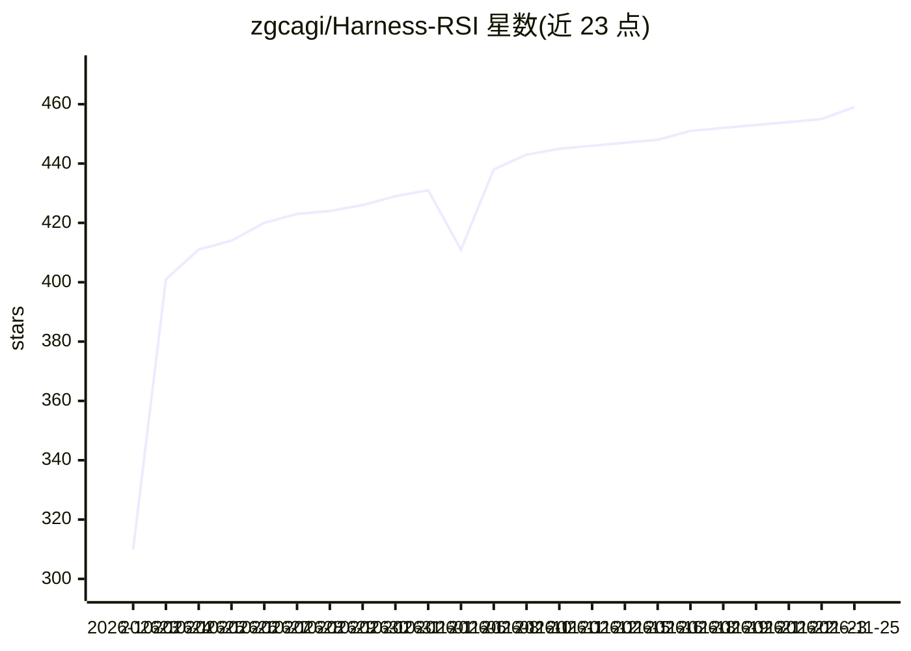

# zgcagi/Harness-RSI

⭐ 459 · TeX · CC-BY-4.0 · 推送 2026-11-13 · [GitHub](https://github.com/zgcagi/Harness-RSI) · [官网](https://zgcagi.github.io/Harness-RSI/) · 组织维护 · 中文 README

**自进化 Agent Harness 综述的论文阅读清单与项目主页**

一份围绕 harness self-evolution（固定基座模型下执行经验转为持久 harness 状态）的双语阅读清单与调研配套材料：给出 harness 形式化定义与更新公式、分类体系（解释型更新/可执行更新/评测/理论），按提示词、记忆与技能、门控整合等子类逐条列出文献，每条附论文/代码/项目链接，并提供 66 页完整报告 PDF、短论文、中文版与引用条目。面向研究该方向的读者。

## 筛选速览

| 维度 | 判定 | 备注 |
|---|---|---|
| AI 角色 | `ai-knowledge` | 知识聚合/清单类 |
| 许可风险 | `viral` | CC-BY-4.0 |
| 部署形态 | `None` |  |
| 模型依赖 | — | README 未给出锁定关系 |
| 硬件要求 | — | 无带数字的原话,不猜 |
| 安装摩擦 | `low` | 无编译、无系统依赖或容器化 |
| 成熟度 | — | 结构信号不足 |

## 能力要点

- 给出 harness 的形式化定义与状态更新公式 H_{k+1}=Update(H_k,B_k)
- 按更新目标分类组织文献：提示词、记忆与程序性技能、门控整合等
- 每条文献附论文、代码或项目页链接，并标注发表 venue
- 提供 66 页完整报告 PDF、18 页短论文及中文版

## 适用场景

- 查找自进化 agent 方向的相关论文与综述
- 了解 prompt 优化、经验记忆、技能沉淀等方法的分类脉络
- 为综述写作收集引用与分类框架

## 场景标签

`精选清单` `科研工具` · 领域:学习与行业

## 证据(README 行号)

> L1: Harness Self-Evolution: Theory, Algorithms, Evaluation, Applications, and Impact
> L13: Companion materials for our survey of how execution experience becomes persistent harness state under a fixed base 
> L25: ## Related Surveys

## 星数曲线

2026-10-23 310 → 2026-11-25 459（+149）

---
*卡片 v1 · prompt 1.4 · 生成 2026-11-25 · 置信度 high · 依据 README sha `cf571a810e96` · [字段定义](../../DATASET.md)*
