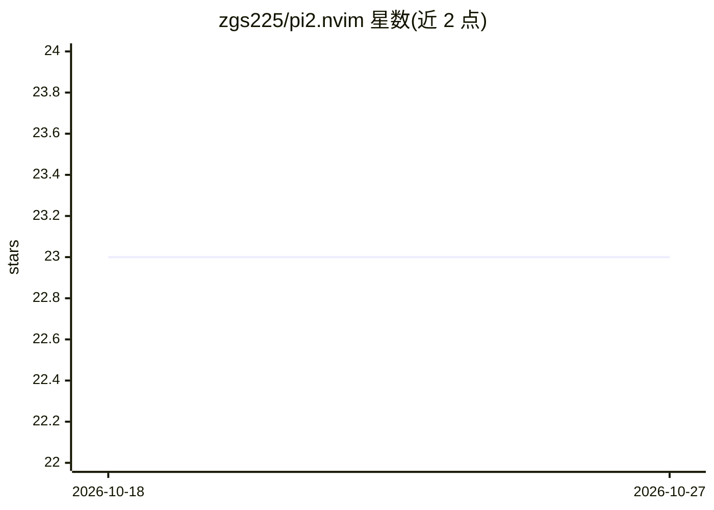

# zgs225/pi2.nvim

⭐ 23 · Lua · MIT · 推送 2026-10-26 · [GitHub](https://github.com/zgs225/pi2.nvim) · 个人维护

**在 Neovim 内使用 pi 编码 agent 的插件（pi.nvim 深度扩展 fork）**

Neovim 插件，后台运行 `pi --mode rpc`，在编辑器内提供项目感知对话、@文件引用、双向 diff 审阅 agent 编辑、会话恢复/分叉，以及并行 sub-agent 编排：父会话可派生独立子会话，各子会话为独立 RPC 进程，有独立模型与思考级别，支持休眠复活与清单持久化。要求 Neovim 0.10+ 与 PATH 中的 pi 0.65.2+，可选图片粘贴、补全等增强。提供 vim.pack / lazy.nvim 安装 spec 与 :checkhealth 健康检查。

## 筛选速览

| 维度 | 判定 | 备注 |
|---|---|---|
| AI 角色 | `ai-ecosystem` | LLM/agent 周边工具 |
| 许可风险 | `permissive` | MIT |
| 部署形态 | `None` |  |
| 模型依赖 | — | README 未给出锁定关系 |
| 硬件要求 | — | 无带数字的原话,不猜 |
| 安装摩擦 | `medium` | 含编译或系统依赖之一 |
| 成熟度 | — | 结构信号不足 |

## 能力要点

- 后台运行 pi --mode rpc，编辑器内对话与 @-mention 精确代码引用
- agent 编辑先经双向 diff 审阅再应用
- 并行 sub-agent：独立模型/思考级别、dormant 休眠复活、清单持久化
- 会话树导航、分叉/克隆、每 tab 独立会话

## 适用场景

- 在 Neovim 中直接驱动 pi 编码 agent 完成项目任务
- 审阅并调整 agent 提出的代码修改
- 从同一父会话派生多个并行子 agent 处理不同任务

## 场景标签

`编码 Agent` · 领域:编码与开发

## 证据(README 行号)

> L16: `pi2.nvim` runs `pi --mode rpc` in the background and gives you an in-editor workflow for project-aware prompts, re
> L98: - `pi` in `$PATH` — **pi 0.65.2+** overall; the vision fallback additionally requires **pi 0.81.0+**; auto session 

## 星数曲线

2026-10-18 23 → 2026-10-27 23（+0）

---
*卡片 v1 · prompt 1.4 · 生成 2026-10-27 · 置信度 high · 依据 README sha `bbdb6149f27d` · [字段定义](../../DATASET.md)*
