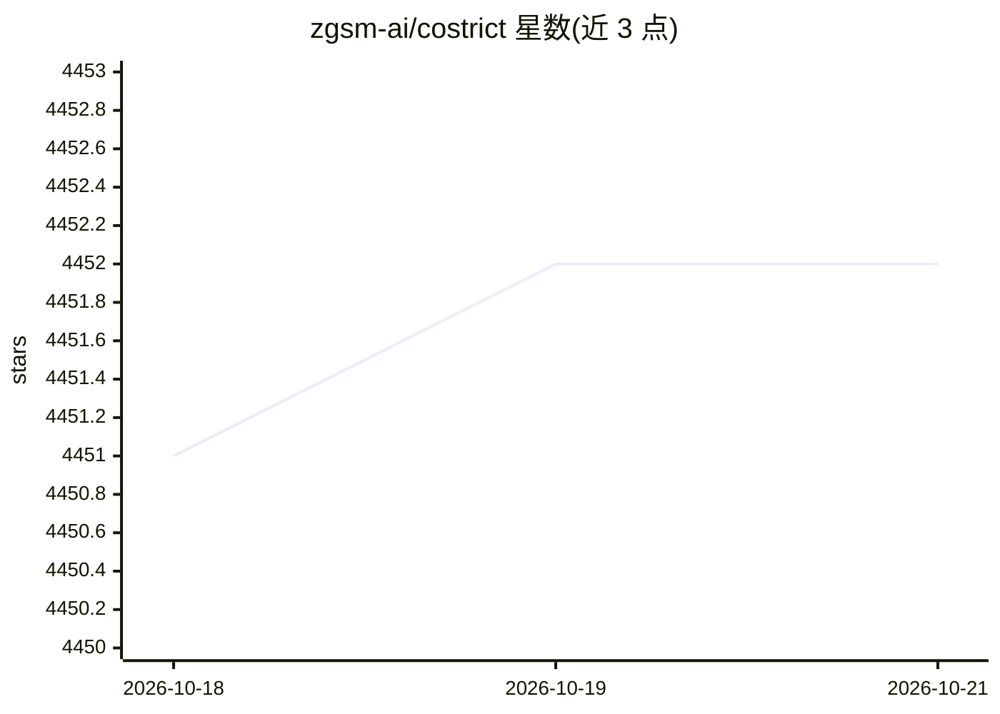

# zgsm-ai/costrict

⭐ 4,452 · TypeScript · Apache-2.0 · 推送 2026-09-30 · [GitHub](https://github.com/zgsm-ai/costrict) · [官网](https://costrict.ai) · 组织维护 · 中文 README

**面向企业的 AI 编码助手：严格模式、代码审查与补全**

开源（Apache 2.0）的企业级 AI 编码助手，由 Sangfor 维护，支持私有化部署。核心功能包括：严格模式（需求分析、架构设计、任务规划、测试生成的标准化代码工作流）、基于 RAG 的全仓库代码审查与多模型校验、自然语言快速开发（Vibe Code）、MCP 集成、多模态输入与可扩展技能系统。模型层支持 Anthropic、OpenAI、OpenAI 兼容 API 及本地模型。分发形式包括 VS Code 扩展、CLI 工具、JetBrains 插件和云端版本。

## 筛选速览

| 维度 | 判定 | 备注 |
|---|---|---|
| AI 角色 | `ai-native` | 本体是模型或模型工具 |
| 许可风险 | `permissive` | Apache-2.0 |
| 部署形态 | `None` |  |
| 模型依赖 | — | README 未给出锁定关系 |
| 硬件要求 | — | 无带数字的原话,不猜 |
| 安装摩擦 | `low` | 无编译、无系统依赖或容器化 |
| 成熟度 | — | 结构信号不足 |

## 能力要点

- 严格模式：需求分析→架构设计→任务规划→测试生成的标准化流程
- 全仓库索引与 RAG 代码审查，多模型校验策略
- 支持 Anthropic/OpenAI/OpenAI 兼容 API 及本地模型，可私有化部署
- 提供 VS Code 扩展、CLI、JetBrains 插件与云版本多种形态

## 适用场景

- 企业内私有化部署 AI 编码助手以满足安全合规要求
- 对全仓库代码做 RAG 分析与多模型代码审查
- 通过自然语言对话快速开发与迭代代码

## 场景标签

`编码 Agent` `代码生成` `代码审查` · 领域:编码与开发

## 证据(README 行号)

> L24: |🔒 **Strict Mode**|Standardized AI code generation with requirements analysis, architecture design, task planning, 
> L26: |🎯 **Vibe Code**|Rapid development through natural language dialogue|
> L88: - 🎛️ **API & Model Customization** - Built-in free models + support for Anthropic, OpenAI, OpenAI-compatible APIs, 

## 星数曲线

2026-10-18 4,451 → 2026-10-21 4,452（+1）

---
*卡片 v1 · prompt 1.4 · 生成 2026-10-20 · 置信度 high · 依据 README sha `7c2ecdd532b7` · [字段定义](../../DATASET.md)*
