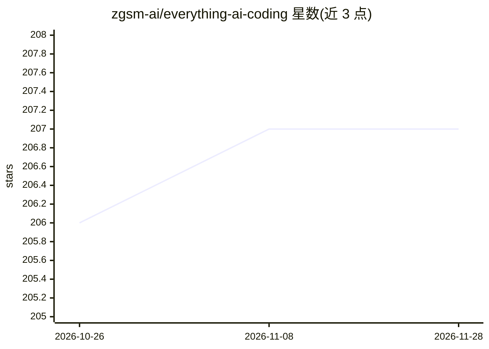

# zgsm-ai/everything-ai-coding

⭐ 207 · Python · MIT · 推送 2026-11-23 · [GitHub](https://github.com/zgsm-ai/everything-ai-coding) · [官网](https://zgsm-ai.github.io/everything-ai-coding/) · 组织维护 · 中文 README

**AI 编程资源聚合库：检索并一键安装 MCP/Skills/Rules/Prompts**

聚合 9+ 上游来源的 AI 编程资源知识库，收录 MCP Servers（5258 条）、Skills（31300 条）、Rules（243 条）、Prompts（984 条）与 Plugins（3371 条）。每条目经 LLM 六维评分与健康信号（新鲜度、star 数、来源信誉）合成 0-100 分，按分数排序展示 Top 100。管道每周自动同步、去重、评估并发布。附带 Coding Hub CLI，可在 Claude Code、Costrict、Opencode、VSCode Costrict (Roo Code) 四个平台内以斜杠命令搜索、浏览、安装资源，提供 shell/PowerShell 安装脚本。

## 筛选速览

| 维度 | 判定 | 备注 |
|---|---|---|
| AI 角色 | `ai-knowledge` | 知识聚合/清单类 |
| 许可风险 | `permissive` | MIT |
| 部署形态 | `None` |  |
| 模型依赖 | — | README 未给出锁定关系 |
| 硬件要求 | — | 无带数字的原话,不猜 |
| 安装摩擦 | `low` | 无编译、无系统依赖或容器化 |
| 成熟度 | — | 结构信号不足 |

## 能力要点

- 聚合 50200+ 资源：MCP Servers、Skills、Rules、Prompts、Plugins 五类
- LLM 六维评分 + 健康信号合成 0-100 分，接受阈值 ≥65
- 每周自动同步上游 9+ 来源并跨源去重
- Coding Hub CLI 支持 /eac:search、/eac:install 等斜杠命令

## 适用场景

- 为 AI 编程 agent 查找可靠的 MCP server 或可复用 skill
- 在 Claude Code 等编辑器内用命令搜索并安装编程资源
- 按质量评分筛选编程 prompt 模板与规范规则

## 场景标签

`精选清单` `提示工程` · 领域:Agent 开发

## 证据(README 行号)

> L24: Everything AI Coding is a **curated knowledge base** that continuously collects, deduplicates, enriches, and scores
> L193: Everything AI Coding supports four AI coding platforms. The resource catalog is shared, while command names and in
> L195: ||Claude Code|Costrict|Opencode|VSCode Costrict (Roo Code)|

## 星数曲线

2026-10-26 206 → 2026-11-28 207（+1）

---
*卡片 v1 · prompt 1.4 · 生成 2026-11-25 · 置信度 high · 依据 README sha `3992163c48e8` · [字段定义](../../DATASET.md)*
