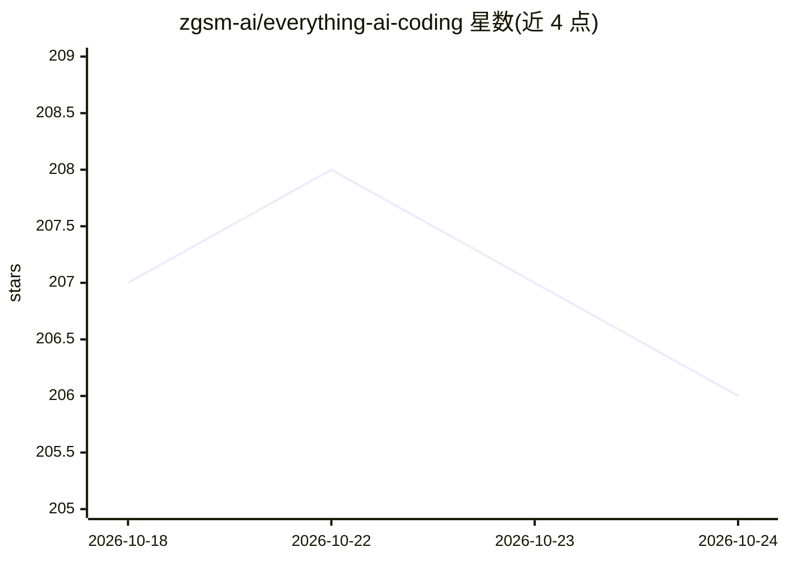

# zgsm-ai/everything-ai-coding

⭐ 206 · Python · MIT · 推送 2026-10-20 · [GitHub](https://github.com/zgsm-ai/everything-ai-coding) · [官网](https://zgsm-ai.github.io/everything-ai-coding/) · 组织维护 · 中文 README

**编程 AI 扩展资源精选目录：MCP/Skills/Rules/Prompts 聚合+一键安装**

从 9+ 上游来源周更采集、去重、打分的 AI 编程资源知识库，收录 MCP Servers（5130 条）、Skills（23089）、Rules（245）、Prompts（770）、Plugins（3359）共约 4 万条；每条含 LLM 打分（编码相关性、文档质量等 6 维）与健康信号（新鲜度、stars），按 final_score=LLM×0.85+health×0.15 排序，≥65 分收录。附 Coding Hub CLI，为 Claude Code、Costrict、Opencode、VSCode Costrict 四个平台提供 search/browse/install 命令，支持 install.sh/install.ps1 一键安装与环境变量自动检测平台，另有面向 AI agent 的自动安装指引。

## 筛选速览

| 维度 | 判定 | 备注 |
|---|---|---|
| AI 角色 | `ai-knowledge` | 知识聚合/清单类 |
| 许可风险 | `permissive` | MIT |
| 部署形态 | `None` |  |
| 模型依赖 | — | README 未给出锁定关系 |
| 硬件要求 | — | 无带数字的原话,不猜 |
| 安装摩擦 | `low` | 无编译、无系统依赖或容器化 |
| 成熟度 | — | 结构信号不足 |

## 能力要点

- 9+ 上游来源周更同步、跨源去重与 LLM 6 维打分（0-100 综合分）
- 约 40,700 条资源，覆盖 MCP/Skills/Rules/Prompts/Plugins 五类
- install.sh / install.ps1 一键安装，适配 4 个 AI 编程平台
- 提供面向 AI agent 的自动安装指引与环境变量平台自动检测

## 适用场景

- 为我的 AI 编程助手查找和安装 MCP Server 或 Skill
- 浏览高分 Rules/Prompts 提升编码 agent 行为一致性
- 评估候选资源的质量与新鲜度后再安装

## 场景标签

`精选清单` · 领域:学习与行业

## 证据(README 行号)

> L24: Everything AI Coding is a **curated knowledge base** that continuously collects, deduplicates, enriches, and scores
> L28: ### 🔌 MCP Servers — 5130 entries

## 星数曲线

2026-10-18 207 → 2026-10-24 206（-1）

---
*卡片 v1 · prompt 1.4 · 生成 2026-10-22 · 置信度 high · 依据 README sha `1e13d2ed9015` · [字段定义](../../DATASET.md)*
