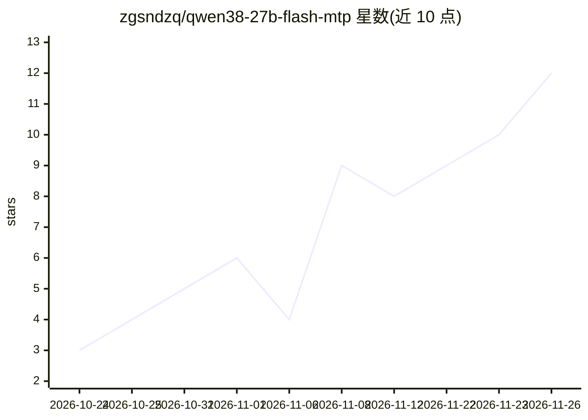

# zgsndzq/qwen38-27b-flash-mtp

⭐ 12 · C++ · Apache-2.0 · 推送 2026-11-25 · [GitHub](https://github.com/zgsndzq/qwen38-27b-flash-mtp) · [官网](https://huggingface.co/SuperLogic/Qwen3.8-27B-Flash-MTP-GGUF) · 个人维护 · 中文 README

**在 8 GB 显存笔记本 GPU 上本地运行 27B 三值量化代码模型的运行包**

一个将三值量化（PTQ1_0）27B 代码模型与 MTP 自投机草稿头合并打包为单一 gguf 的运行包：权重 5.79 GB，配合 fork 版 llama.cpp 引擎在 8 GB 消费级显卡上整模型驻留。提供 Windows 预编译二进制（含 CUDA 运行时）、llmserver.bat 启动脚本、features.ini fork 专属开关及命令行聊天客户端，通过 OpenAI 风格 HTTP API（127.0.0.1:18080）提供服务。权重为衍生作品（基于 Qwen3.8-27B 等多层合并，未重新训练），Apache 2.0 许可并要求 Bonsai 署名。

## 筛选速览

| 维度 | 判定 | 备注 |
|---|---|---|
| AI 角色 | `ai-ecosystem` | LLM/agent 周边工具 |
| 许可风险 | `permissive` | Apache-2.0 |
| 部署形态 | `desktop` | 安装包/桌面程序 |
| 模型依赖 | — | README 未给出锁定关系 |
| 硬件要求 | `gpu-8g` | |
| 安装摩擦 | `high` | 编译与系统依赖俱全 |
| 成熟度 | — | 结构信号不足 |

## 能力要点

- 权重 5.79 GB，8 GB 显存显卡可整模型驻留，README 给出 RTX 4060 Laptop 上的分场景速度数据
- MTP 草稿头烘在同一个 gguf 内，依赖 PrismML-Eng/llama.cpp 的 fork（官方 llama.cpp 无法加载该格式）
- 预编译 zip 与源码编译两条获取路径，附 nvcc 静默失败等编译排障说明
- features.ini 提供 KV 显存分配、稀疏读取、chunk prefill 等 fork 专属配置项

## 适用场景

- 在 8 GB 显存笔记本 GPU 上本地跑 27B 代码模型
- 通过本地 HTTP API 接入自己的客户端调用模型
- 需要 128K 上下文且显存受限的本地推理部署

## 场景标签

`推理引擎` `模型量化` · 领域:训练与推理

## 证据(README 行号)

> L3: 三值量化（`PTQ1_0`）的 27B 代码模型，MTP 自投机草稿头**烘在同一个 gguf 里**。
> L6: 引擎是对 `PrismML-Eng/llama.cpp` 的 fork —— 官方 llama.cpp **跑不了这个模型**
> L38: **不需要编译**，双击 `llmserver.bat`。看到这两行就成了：
> L48: curl http://127.0.0.1:18080/v1/chat/completions \

## 星数曲线

2026-10-24 3 → 2026-11-26 12（+9）

---
*卡片 v1 · prompt 1.4 · 生成 2026-11-20 · 置信度 mid · 依据 README sha `48dd421eb2d0` · [字段定义](../../DATASET.md)*
