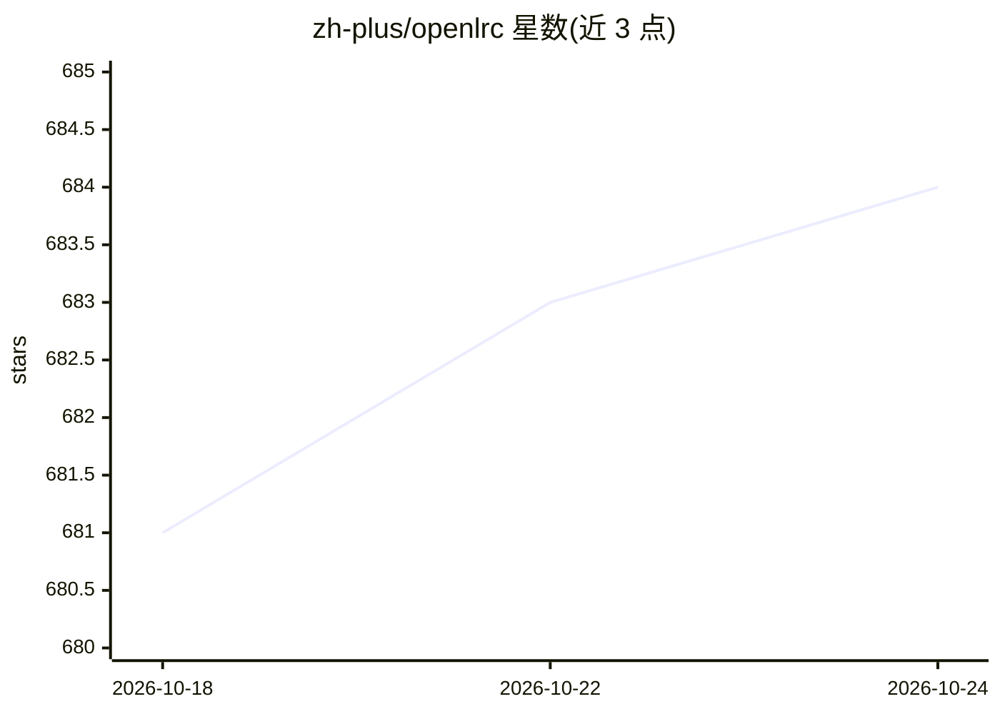

# zh-plus/openlrc

⭐ 684 · Python · MIT · 推送 2026-08-10 · [GitHub](https://github.com/zh-plus/openlrc) · [官网](https://zh-plus.github.io/openlrc/) · 个人维护 · 中文 README

**用 Whisper+LLM 将音频转录翻译为 LRC 字幕的 Python 库**

Python 库 Open-Lyrics：用 faster-whisper 转录音频，再调用 OpenAI/Anthropic/Google/OpenRouter/DeepSeek 等 LLM 进行上下文感知的翻译与润色，输出 .lrc 字幕；支持术语表、混合模型精益翻译模式、批处理与多文件异步、多种输出格式。安装需 CUDA/cuDNN/cuBLAS（faster-whisper）与 ffmpeg，噪声抑制与 LiteLLM 为可选 extras，另有 Streamlit 网页 GUI。面向需要音频转字幕并翻译的开发者。

## 筛选速览

| 维度 | 判定 | 备注 |
|---|---|---|
| AI 角色 | `ai-native` | 本体是模型或模型工具 |
| 许可风险 | `permissive` | MIT |
| 部署形态 | `library` | 以包/库形式分发 |
| 模型依赖 | locked-api |  |
| 硬件要求 | — | 无带数字的原话,不猜 |
| 安装摩擦 | `medium` | 含编译或系统依赖之一 |
| 成熟度 | — | 结构信号不足 |

## 能力要点

- faster-whisper 转录 + LLM 上下文感知翻译/润色，输出 .lrc 字幕
- 支持 OpenAI/Anthropic/Google/OpenRouter/DeepSeek/Azure 等多家模型与自定义端点、本地 LLM
- 术语表与混合模型精益翻译模式（廉价 MT 模型 + 较大 CR 模型）
- 音频预处理（响度归一化与可选降噪 DPDFNet）以减少幻觉

## 适用场景

- 把播客、有声书、歌曲音频转成带时间轴的翻译字幕
- 为视频/音频内容生成中文 LRC 歌词或字幕文件
- 领域内容（如游戏术语）借助术语表获得一致的翻译

## 场景标签

 · 领域:语音处理/字幕生成

## 证据(README 行号)

> L8: Open-Lyrics is a Python library that transcribes audio with
> L10: into `.lrc` subtitles with LLMs such as

## 星数曲线

2026-10-18 681 → 2026-10-24 684（+3）

---
*卡片 v1 · prompt 1.4 · 生成 2026-10-21 · 置信度 high · 依据 README sha `01aeefa3aeb8` · [字段定义](../../DATASET.md)*
