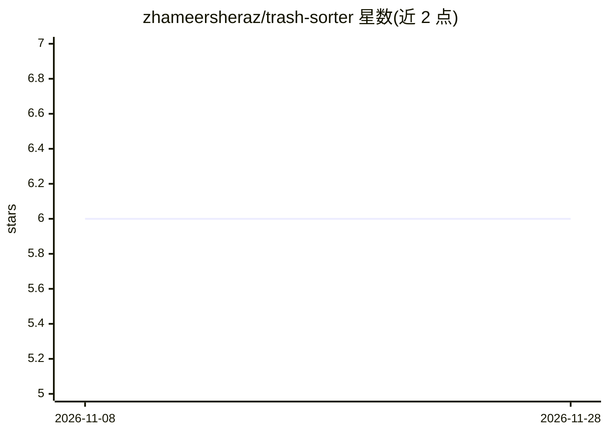

# zhameersheraz/trash-sorter

⭐ 6 · JavaScript · 推送 2026-10-24 · [GitHub](https://github.com/zhameersheraz/trash-sorter) · [官网](https://trash-sorter.enjeanearz.workers.dev/) · 组织维护

**浏览器端垃圾分类识别 Web 应用：摄像头对准垃圾即显示对应垃圾桶**

基于 Google Teachable Machine 训练的图像分类模型（5 类、817 张精选图片），导出为 TensorFlow.js 格式，在浏览器本地运行推理——不经过服务器、不上传摄像头画面。应用读取摄像头帧或本地照片，每秒约 5 次预测，输出类别与对应垃圾桶颜色；置信度低于 0.75 时显示 Uncertain。依赖库 vendor 进仓库，支持离线运行；通过任意静态服务器部署，README 提供源码本地运行步骤。

## 筛选速览

| 维度 | 判定 | 备注 |
|---|---|---|
| AI 角色 | `ai-native` | 本体是模型或模型工具 |
| 许可风险 | `none` | — |
| 部署形态 | `None` |  |
| 模型依赖 | — | README 未给出锁定关系 |
| 硬件要求 | — | 无带数字的原话,不猜 |
| 安装摩擦 | `low` | 无编译、无系统依赖或容器化 |
| 成熟度 | — | 结构信号不足 |

## 能力要点

- Teachable Machine 训练的 5 类图像分类模型，TensorFlow.js 浏览器内推理
- 无服务器、无 API 调用、不上传摄像头画面，依赖已 vendor 可离线运行
- 0.75 置信度阈值，低于阈值显示 Uncertain 而非给出分类
- 摄像头实时帧与本地照片两种输入模式

## 适用场景

- 家庭或学校垃圾分类演示教学
- 摄像头前快速判断物品应投入哪个回收桶
- 无网络环境下运行本地分类演示

## 场景标签

`目标检测` · 领域:感知与多模态

## 证据(README 行号)

> L5: An AI waste-classification web app. A custom image model trained in
> L7: in the browser on TensorFlow.js — no server, no API calls, no upload of camera
> L49: 3. `app.js` loads it with `@teachablemachine/image` and runs a

## 星数曲线

2026-11-08 6 → 2026-11-28 6（+0）

---
*卡片 v1 · prompt 1.4 · 生成 2026-11-20 · 置信度 high · 依据 README sha `e961e0a21e2d` · [字段定义](../../DATASET.md)*
