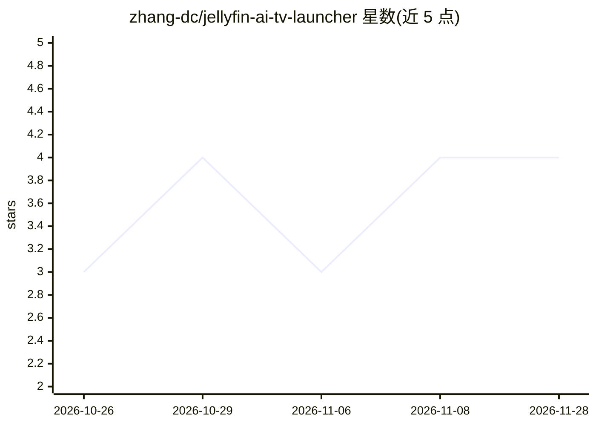

# zhang-dc/jellyfin-ai-tv-launcher

⭐ 4 · Java · MIT · 推送 2026-11-03 · [GitHub](https://github.com/zhang-dc/jellyfin-ai-tv-launcher) · 个人维护 · 中文 README

**给国产小米电视的极简无广告桌面：接 Jellyfin、AI 助手与去预装**

面向 Android TV 与中国大陆小米电视的启动器 APK 源码仓库，提供媒体桌面（继续观看/最近添加行、内置 ExoPlayer 播放器、字幕实时校时）、按住 OK 键与内置语音按钮语音输入的 AI 助手问答入口，以及通过 ADB 可逆禁用预装广告包的维护脚本。AI 后端、语音识别与内容搜索均由用户自建，仓库只交付接口契约文档。构建脚本默认面向 Windows，需 JDK 17 与 Node.js，产物为签名 APK 经 ADB 安装。

## 筛选速览

| 维度 | 判定 | 备注 |
|---|---|---|
| AI 角色 | `ai-enhanced` | 去掉 AI 部分产品仍成立 |
| 许可风险 | `permissive` | MIT |
| 部署形态 | `desktop` | 安装包/桌面程序 |
| 模型依赖 | — | README 未给出锁定关系 |
| 硬件要求 | — | 无带数字的原话,不猜 |
| 安装摩擦 | `medium` | 含编译或系统依赖之一 |
| 成熟度 | — | 结构信号不足 |

## 能力要点

- 从 Jellyfin 服务器读取继续观看/最近添加行并直接起播
- 按住 OK 说话或遥控器语音键与自建 AI agent 对话
- 字幕可实时 0.1s 步进校时或对齐台词自动计算偏移
- ADB 去预装脚本完全可逆，配套备份/恢复命令

## 适用场景

- 把大陆版小米电视的广吿桌面换成无推荐行的媒体桌面
- 在电视上语音向自己的 AI agent 提问
- 家庭 Jellyfin 服务器在电视端的直接播放入口
- 禁用电视预装广告与分析包且可随时还原

## 场景标签

`AI 助手` · 领域:对话与助手

## 证据(README 行号)

> L5: A **minimal, ad-free launcher** for Android TV and mainland-China Xiaomi TVs that brings your home media server and 
> L13: - **Ask** — talk to your own AI agent: hold OK and speak into the TV, press the remote's voice button (transcribed 
> L23: Only the **TV side**: the launcher APK source and an ADB maintenance script. Backends (AI agent, speech recognition

## 星数曲线

2026-10-26 3 → 2026-11-28 4（+1）

---
*卡片 v1 · prompt 1.4 · 生成 2026-11-21 · 置信度 high · 依据 README sha `c5af970f067a` · [字段定义](../../DATASET.md)*
