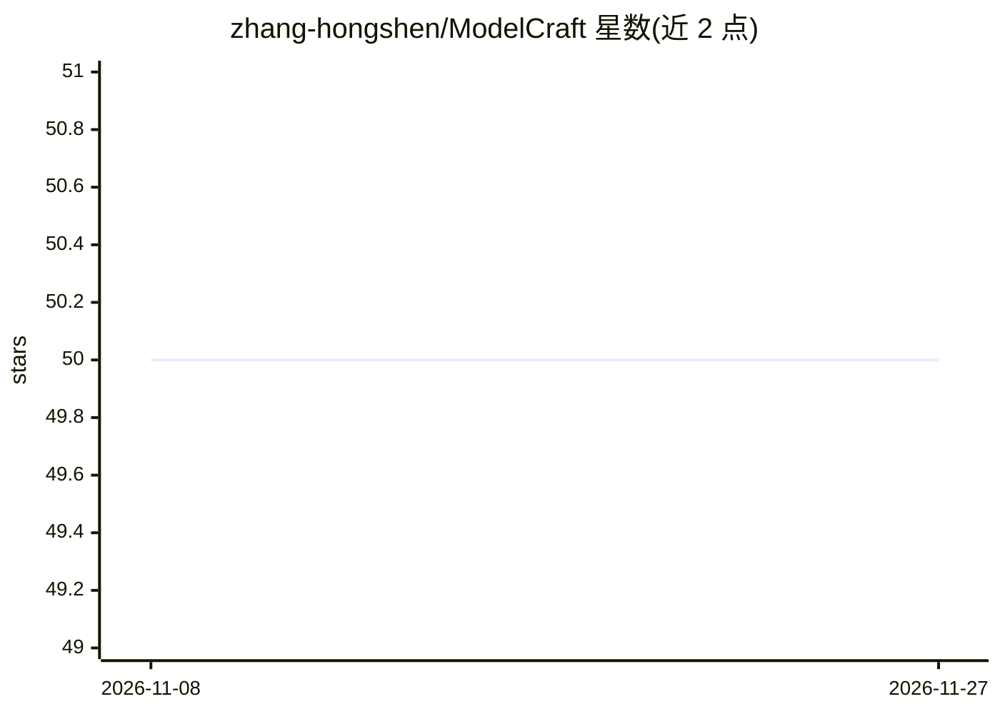

# zhang-hongshen/ModelCraft

⭐ 50 · Swift · MIT · 推送 2026-11-21 · [GitHub](https://github.com/zhang-hongshen/ModelCraft) · [官网](https://zhanghongshen.com/products/modelcraft) · 个人维护

**macOS 本地优先 AI 助手：运行 MLX 模型与 agent 工具**

面向 Apple silicon Mac 的本地优先 AI 助手应用，以 Swift 编写。支持从 Model Store 下载并本地运行 MLX 文本与多模态模型；agent 工具覆盖文件、命令、网页访问、连接的应用与屏幕交互；提供项目管理、全局快捷键 Quick Entry、会话导入、本地语音识别听写，以及计划任务与图像/音频/音乐/视频生成。要求 macOS 15+ Apple silicon，可通过 GitHub Releases 的 DMG 安装或用 Xcode 从源码构建。

## 筛选速览

| 维度 | 判定 | 备注 |
|---|---|---|
| AI 角色 | `ai-native` | 本体是模型或模型工具 |
| 许可风险 | `permissive` | MIT |
| 部署形态 | `None` |  |
| 模型依赖 | — | README 未给出锁定关系 |
| 硬件要求 | — | 无带数字的原话,不猜 |
| 安装摩擦 | `low` | 无编译、无系统依赖或容器化 |
| 成熟度 | — | 结构信号不足 |

## 能力要点

- 本地下载并运行 MLX 文本与多模态模型
- agent 工具：文件、命令、网页、连接应用与屏幕交互
- 全局快捷键 Quick Entry 可附加上下文（文件/网页/选中文本/图片）
- 本地语音识别听写与计划任务、多模态内容生成

## 适用场景

- 在 Mac 上离线使用本地模型进行对话与多模态任务
- 通过 agent 工具让助手操作文件、命令与连接的应用
- 从任意应用经 Quick Entry 快速发起带上下文的请求

## 场景标签

`AI 助手` `多模态` `语音识别` `视频生成` · 领域:对话与助手

## 证据(README 行号)

> L5: Local-first AI assistant for macOS with MLX models, agent tools, projects, quick entry and session import.
> L11: - Download and run local models for text and multimodal conversations.

## 星数曲线

2026-11-08 50 → 2026-11-27 50（+0）

---
*卡片 v1 · prompt 1.4 · 生成 2026-11-18 · 置信度 high · 依据 README sha `cca111ec2dfd` · [字段定义](../../DATASET.md)*
