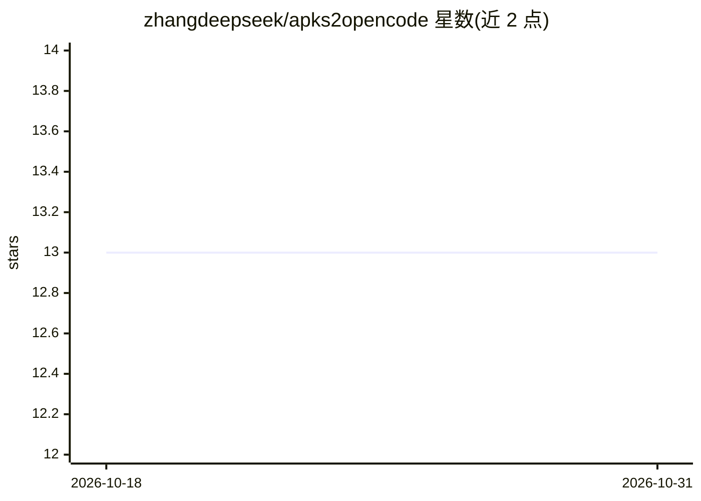

# zhangdeepseek/apks2opencode

⭐ 13 · Shell · MIT · 推送 2026-10-14 · [GitHub](https://github.com/zhangdeepseek/apks2opencode) · 个人维护 · 中文 README

**Docker 化 APK 逆向分析流水线：反编译+语义索引+AI 问答**

基于 Docker Compose 的 APK 逆向工程环境：jadx-ai-mcp 提供 JADX GUI（noVNC 访问）与 MCP 反编译服务，jrag 对反编译源码构建语义索引与调用图（向量检索+图查询），OpenCode AI Agent 通过 MCP 协议调用两者，用户以自然语言提问即可定位类、追踪调用链。支持 add_apk.sh 一键添加 APK、多 APK 子目录隔离、索引持久化与增量更新。需自备 OpenAI 兼容 API（DeepSeek/OpenAI 等）。限制：jadx GUI 单次只能加载一个 APK、jrag 图查询不跨 APK、默认嵌入模型中文语义有限、大型 APK（10k+ 类）初始索引约需 1 小时。

## 筛选速览

| 维度 | 判定 | 备注 |
|---|---|---|
| AI 角色 | `ai-native` | 本体是模型或模型工具 |
| 许可风险 | `permissive` | MIT |
| 部署形态 | `self-host` | docker 或自建部署 |
| 模型依赖 | — | README 未给出锁定关系 |
| 硬件要求 | — | 无带数字的原话,不猜 |
| 安装摩擦 | `low` | 无编译、无系统依赖或容器化 |
| 成熟度 | — | 结构信号不足 |

## 能力要点

- docker compose up 一键启动 JADX 反编译 + jrag 语义索引 + OpenCode AI Agent 全套环境
- jrag 提供向量检索与调用链图查询（neighbors/callers）
- 索引全本地持久化，支持增量更新与多 APK 子目录隔离
- 可安装逆向工程与移动静态分析类 OpenCode Skills

## 适用场景

- 用自然语言询问 APK 中的支付逻辑、Activity 列表或函数调用方
- 对多个 APK 做本地化的反编译代码语义检索与调用链追踪
- 搭建即开即用的移动应用逆向分析工作环境

## 场景标签

`RAG` `语义搜索` `网络安全` · 领域:知识与检索

## 证据(README 行号)

> L5: A Docker-based environment for APK reverse engineering and analysis. It integrates JADX (decompilation), jrag (seman
> L24: - **opencode**: An AI Agent that invokes jrag and jadx via the MCP protocol.
> L104: ```

## 星数曲线



2026-10-18 13 → 2026-10-31 13（+0）


---
*卡片 v1 · prompt 1.4 · 生成 2026-10-31 · 置信度 high · 依据 README sha `be8cc1f4193a` · [字段定义](../../DATASET.md)*
