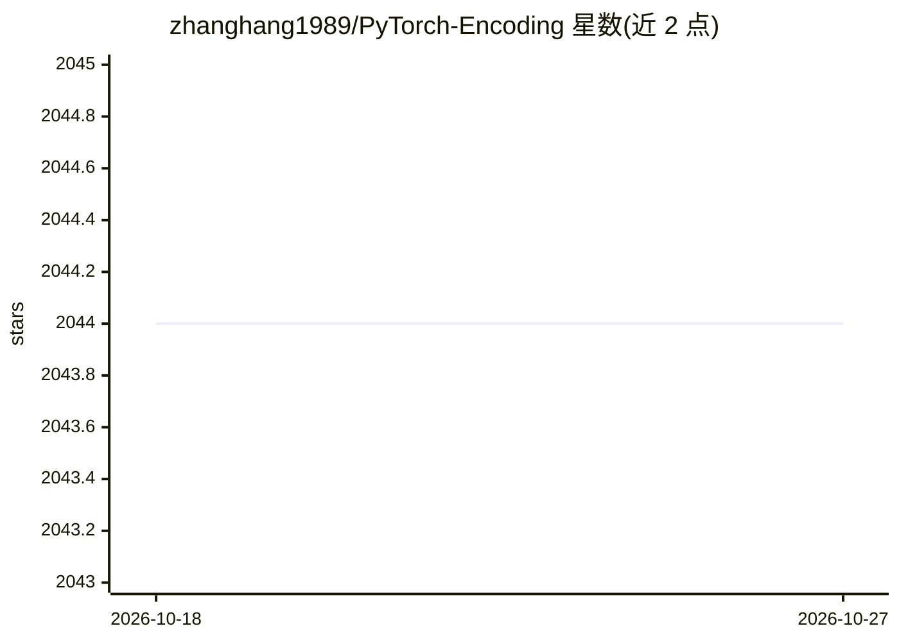

# zhanghang1989/PyTorch-Encoding

⭐ 2,044 · Python · MIT · 推送 2026-09-11 · [GitHub](https://github.com/zhanghang1989/PyTorch-Encoding) · [官网](https://hangzhang.org/PyTorch-Encoding/) · 个人维护

**PyTorch 计算机视觉工具包：论文模型与同步 BatchNorm 等层**

Hang Zhang 维护的 PyTorch 扩展工具包，收录其系列论文的实现：Deep TEN 纹理编码网络、Context Encoding 语义分割、ResNeSt Split-Attention 网络等，并提供 Encoding Layer 与跨卡同步 BatchNorm 等构件。面向使用 PyTorch 做图像分类与语义分割的研究者与开发者，具体安装与使用方法在 Docs 文档站中给出，README 本身不包含安装命令。

## 筛选速览

| 维度 | 判定 | 备注 |
|---|---|---|
| AI 角色 | `ai-native` | 本体是模型或模型工具 |
| 许可风险 | `permissive` | MIT |
| 部署形态 | `None` |  |
| 模型依赖 | — | README 未给出锁定关系 |
| 硬件要求 | — | 无带数字的原话,不猜 |
| 安装摩擦 | `low` | 无编译、无系统依赖或容器化 |
| 成熟度 | — | 结构信号不足 |

## 能力要点

- 收录 ResNeSt、Context Encoding、Deep TEN 等论文模型实现
- 提供 Encoding Layer 与 Synchronized BatchNorm 组件
- 提供图像分类与语义分割模型列表（见 Docs）

## 适用场景

- 复现或使用 ResNeSt 等论文模型做图像分类
- 语义分割任务的模型与组件来源
- 多卡训练中使用同步 BatchNorm 层

## 场景标签

`目标检测` · 领域:感知与多模态

## 证据(README 行号)

> L16: - Please visit the link to image classification models.
> L18: - Please visit the link to semantic segmentation models.
> L22: **ResNeSt: Split-Attention Networks** [[arXiv]](https://arxiv.org/abs/2004.08955)

## 星数曲线

2026-10-18 2,044 → 2026-10-27 2,044（+0）

---
*卡片 v1 · prompt 1.4 · 生成 2026-10-21 · 置信度 mid · 依据 README sha `08bc0a3d3209` · [字段定义](../../DATASET.md)*
