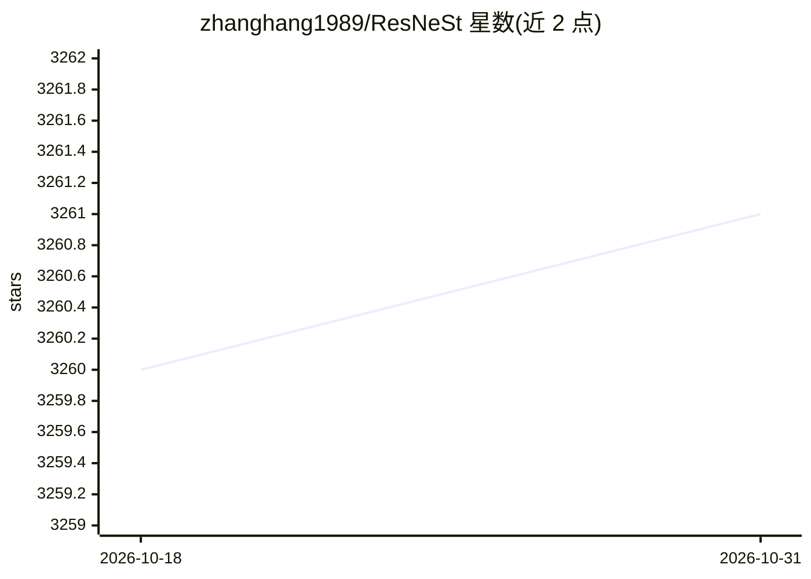

# zhanghang1989/ResNeSt

⭐ 3,261 · Python · Apache-2.0 · 推送 2026-09-11 · [GitHub](https://github.com/zhanghang1989/ResNeSt) · [官网](https://arxiv.org/abs/2004.08955) · 个人维护

**ResNeSt：Split-Attention 结构的 ResNet 变体模型库，供视觉任务使用**

提供 ResNeSt 系列 Split-Attention 网络的 PyTorch 与 Gluon(MXNet) 实现及 ImageNet 预训练模型（ResNeSt-50/101/200/269），可通过 pip、Torch Hub 或 Python 包加载。附带 detectron2 封装与训练配置用于目标检测/实例分割，骨干网络被 MMDetection 采用，语义分割训练指向 Encoding 与 GluonCV 工具包。含 ImageNet 结果验证与训练脚本。供计算机视觉研究与开发者做图像分类、检测、分割的骨干网络选型。论文见 arXiv:2004.08955。

## 筛选速览

| 维度 | 判定 | 备注 |
|---|---|---|
| AI 角色 | `ai-native` | 本体是模型或模型工具 |
| 许可风险 | `permissive` | Apache-2.0 |
| 部署形态 | `library` | 以包/库形式分发 |
| 模型依赖 | — | README 未给出锁定关系 |
| 硬件要求 | — | 无带数字的原话,不猜 |
| 安装摩擦 | `low` | 无编译、无系统依赖或容器化 |
| 成熟度 | — | 结构信号不足 |

## 能力要点

- PyTorch 与 Gluon 双实现，提供 ResNeSt-50/101/200/269 预训练模型
- Torch Hub 一行加载预训练模型
- detectron2 封装用于检测/实例分割，骨干被 MMDetection 采用
- 提供 ImageNet 验证脚本与训练入口

## 适用场景

- 为图像分类任务加载 ImageNet 预训练骨干
- 以 ResNeSt 为 backbone 做目标检测与实例分割
- 复现论文 ImageNet 精度结果

## 场景标签

 · 领域:计算机视觉/深度学习模型

## 证据(README 行号)

> L17: Split-Attention Network, A New ResNet Variant. It significantly boosts the performance of downstream models such as
> L35: ||crop size|PyTorch|Gluon|
> L81: We provide a wrapper for training Detectron2 models with ResNeSt backbone at d2. Training configs and pretrained mo

## 星数曲线

2026-10-18 3,260 → 2026-10-31 3,261（+1）

---
*卡片 v1 · prompt 1.4 · 生成 2026-10-20 · 置信度 high · 依据 README sha `add9f412f5de` · [字段定义](../../DATASET.md)*
