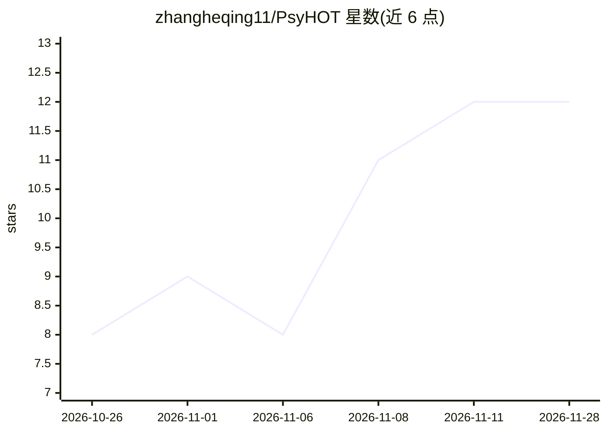

# zhangheqing11/PsyHOT

⭐ 12 · TypeScript · MIT · 推送 2026-11-19 · [GitHub](https://github.com/zhangheqing11/PsyHOT) · 个人维护 · 中文 README

**心理学/精神医学研究日报站：模型筛选94信源出中文精选**

基于 AIHOT 开源框架改造的心理学与精神医学资讯聚合站点，覆盖期刊、预印本、学会、监管机构和媒体共 95 个信源。流程为采集判重、模型预筛、两次独立评分（学界按五维打分换算百分制）、中文写作、同事件聚簇、热度榜，每天 08:00 生成日报、每周周报、每月月报。面向有专业基础、时间有限的心理咨询师、临床工作者、研究者和学生。运行需 Docker 与一个 OpenAI 兼容模型 API Key，提示词与入选门槛可在 industry/ 目录下调整。

## 筛选速览

| 维度 | 判定 | 备注 |
|---|---|---|
| AI 角色 | `ai-native` | 本体是模型或模型工具 |
| 许可风险 | `permissive` | MIT |
| 部署形态 | `self-host` | docker 或自建部署 |
| 模型依赖 | — | README 未给出锁定关系 |
| 硬件要求 | — | 无带数字的原话,不猜 |
| 安装摩擦 | `low` | 无编译、无系统依赖或容器化 |
| 成熟度 | — | 结构信号不足 |

## 能力要点

- 95 个信源经过项目自有抓取代码验证可达，学界/业界双视角分类
- 条目两次独立模型评分，学界按重要性、新颖性、可信度、关联性、实用性五维打分
- 提示词与入选门槛集中在 industry/prompts 与 selection.ts，改标准不需改代码
- 支持后台标注抽样导出 gold.jsonl 并用脚本评测精选效果

## 适用场景

- 每天早晨读一份心理学研究中文日报，掌握领域新进展
- 临床与咨询从业者筛选值得看的精神医学研究
- 研究者跟踪同一研究的论文、新闻稿与评论的故事线
- 自部署并调整信源与筛选标准做领域垂直资讯站

## 场景标签

 · 领域:资讯聚合/心理健康

## 证据(README 行号)

> L29: 心理学的新研究每天散落在几十本期刊、预印本服务器、学会官网和科普媒体里，其中大部分是窄范式的小改进、横断面的小样本相关，或者夸大了结论的新闻稿。PsyHOT 替你把这些都读一遍，只把真正值得知道的几条写成中文标题和摘要，放到首页和
> L33: PsyHOT 基于 AIHOT 开源框架改造。框架负责采集、精选、聚簇、热度和日报；本仓库把信源、分类、提示词和视觉都换成了心理学方向。
> L41: 3. **评分**：先独立打两次分。学界条目均分达到 30 后，由思考模型按重要性、新颖性、可信度、关联性和实用性五个维度各打 1–4 分，等权相加换算到 0–100，再按信源分级门槛判断是否入选；业界保留两次独立评分的现行规则。

## 星数曲线

2026-10-26 8 → 2026-11-28 12（+4）

---
*卡片 v1 · prompt 1.4 · 生成 2026-11-18 · 置信度 high · 依据 README sha `487427a01823` · [字段定义](../../DATASET.md)*
