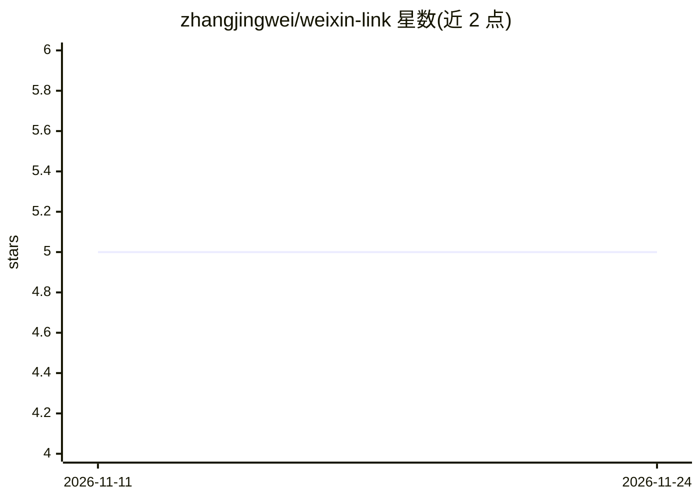

# zhangjingwei/weixin-link

⭐ 5 · JavaScript · MIT · 推送 2026-11-11 · [GitHub](https://github.com/zhangjingwei/weixin-link) · 个人维护 · 中文 README

**在微信里遥控专属 AI 助手干活的自托管工具**

一个自托管的微信接入层：用户在自己的电脑上运行服务，通过微信对话向专属 AI 下达任务，支持语音、图片、PDF/Office 附件输入，可执行查资料、编程、生成文件等任务并在微信中查看进度、补充要求或停止。支持多账号登录与私有化部署，模型由用户自选（Codex 订阅或 DeepSeek、Qwen、Kimi 等 API Key）。状态为 Preview，需 Node.js 24+，MIT 许可。

## 筛选速览

| 维度 | 判定 | 备注 |
|---|---|---|
| AI 角色 | `ai-native` | 本体是模型或模型工具 |
| 许可风险 | `permissive` | MIT |
| 部署形态 | `None` |  |
| 模型依赖 | — | README 未给出锁定关系 |
| 硬件要求 | — | 无带数字的原话,不猜 |
| 安装摩擦 | `low` | 无编译、无系统依赖或容器化 |
| 成熟度 | `idea` | |

## 能力要点

- 微信对话下达任务，支持语音、图片、附件输入与文件交付
- 任务状态保留，支持多会话切换、补充要求与停止任务
- 模型自选：Codex 订阅登录或 DeepSeek/Qwen/Kimi API Key
- 提供 Linux/macOS/Windows 一键安装脚本与微信内更新命令

## 适用场景

- 离开电脑后在微信里继续处理代码任务
- 把手机上的 PDF 发给 AI 提取关键信息
- 私有化部署个人助理，账号密钥自己保管

## 场景标签

`AI 助手` `聊天机器人` · 领域:对话与助手

## 证据(README 行号)

> L3: **你的专属 AI 助手，随时在微信里。**
> L19: **更好用的智能：** 模型你来选，智能体来干活：会规划、会用工具，复杂的事也能从头做到尾。

## 星数曲线

2026-11-11 5 → 2026-11-24 5（+0）

---
*卡片 v1 · prompt 1.4 · 生成 2026-11-20 · 置信度 high · 依据 README sha `55be073948f0` · [字段定义](../../DATASET.md)*
