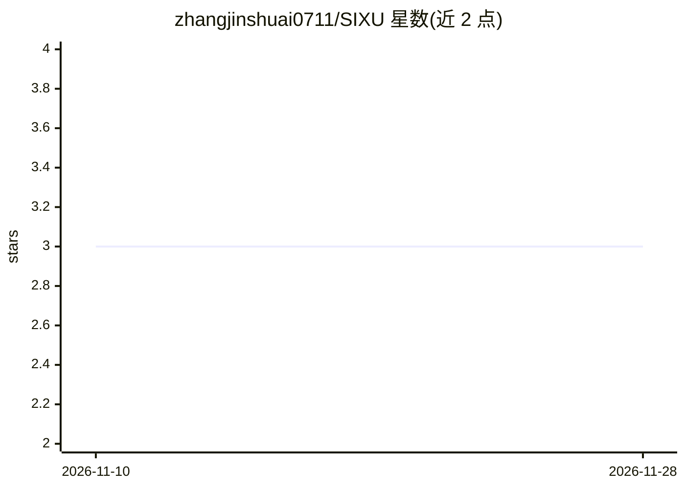

# zhangjinshuai0711/SIXU

⭐ 3 · JavaScript · 推送 2026-11-10 · [GitHub](https://github.com/zhangjinshuai0711/SIXU) · 个人维护 · 中文 README

**为 MCP 聊天客户端提供多阶段推理工作流编排的自托管服务**

SIXU 是面向支持自定义 MCP 工具的聊天客户端（如 ChatGPT Instant）的推理工作流编排器：聊天模型负责生成候选与审查内容，SIXU 服务负责阶段调度、候选版本管理、任务状态持久化及已声明的程序检查（算术、结构、部分约束）。通过 INPUT、EXPAND、BRANCH、CHALLENGE、VERIFY、REVISE、FINALIZE 等阶段组织推理，深度模式要求至少两个候选实际比较。需 Node.js 22+ 自部署，不调用其他模型 API，本仓库未指定开源许可证。

## 筛选速览

| 维度 | 判定 | 备注 |
|---|---|---|
| AI 角色 | `ai-ecosystem` | LLM/agent 周边工具 |
| 许可风险 | `none` | — |
| 部署形态 | `None` |  |
| 模型依赖 | — | README 未给出锁定关系 |
| 硬件要求 | — | 无带数字的原话,不猜 |
| 安装摩擦 | `low` | 无编译、无系统依赖或容器化 |
| 成熟度 | — | 结构信号不足 |

## 能力要点

- 多候选比较与版本化纠错（旧审查不能冒充新版本证据）
- 有限程序校验：可执行已声明且受支持的算术/结构/约束检查
- 可恢复任务状态：保存 run_id、阶段、候选和审查结果
- 不调用其他模型或付费 API，生成由宿主聊天模型承担

## 适用场景

- 多约束规划与方案权衡类问题的结构化推理
- 可核对的计算题并保留审查修订记录
- 在 ChatGPT Instant 中接入自定义 MCP 工具处理复杂任务

## 场景标签

`Agent 框架` `提示工程` · 领域:Agent 开发

## 证据(README 行号)

> L20: **SIXU（思序）是一个面向支持自定义 MCP 工具的聊天客户端的推理工作流编排器。** 当前聊天模型负责生成候选和审查内容；思序服务负责阶段调度、候选版本、任务状态，以及已声明且受支持的程序检查。
> L244: 思序本身**不调用其他模型或付费模型 API**；模型生成仍由当前聊天承担。因此不需要另行给思序提供 OpenAI API Key。

## 星数曲线

2026-11-10 3 → 2026-11-28 3（+0）

---
*卡片 v1 · prompt 1.4 · 生成 2026-11-21 · 置信度 high · 依据 README sha `8c8fcda1b857` · [字段定义](../../DATASET.md)*
