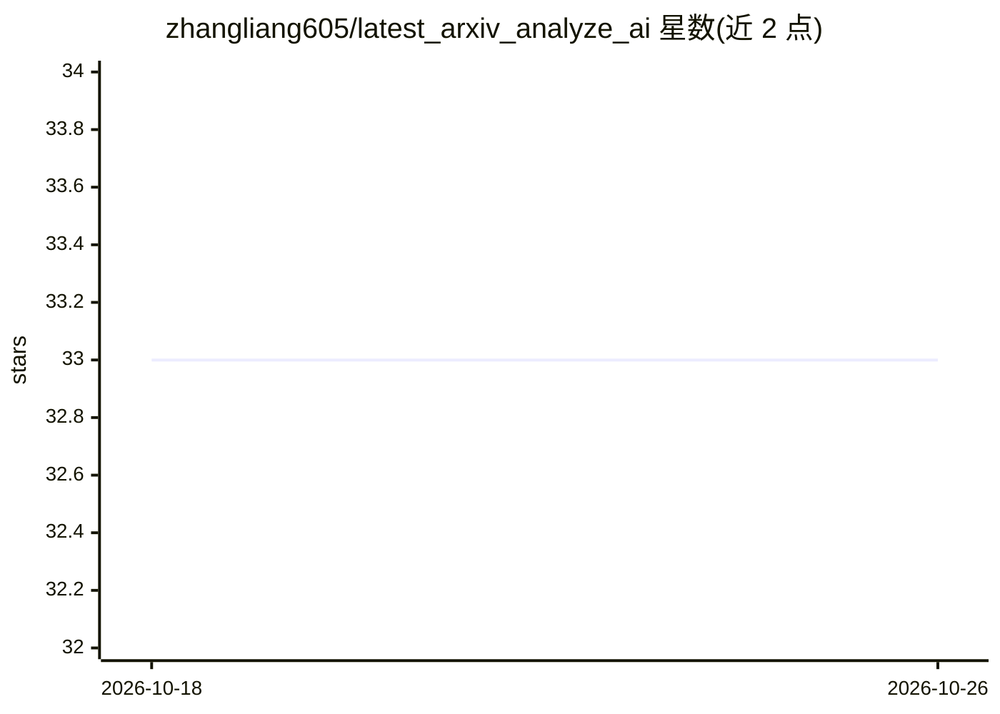

# zhangliang605/latest_arxiv_analyze_ai

⭐ 33 · Python · Apache-2.0 · 推送 2026-10-25 · [GitHub](https://github.com/zhangliang605/latest_arxiv_analyze_ai) · 个人维护

**每日用 LLM 分析 600+ 篇 arXiv 最新论文并输出摘要订阅**

自动化论文追踪项目：按主题（cs.AI、cs.CL、cs.CV、cs.LG、cs.SE 等）抓取最新 arXiv 论文，用 LLM 提取 background、innovation、conclusion 三个字段，每日导出 markdown 文件与 RSS/ATOM 订阅源，供读者订阅获取 AI 分析的论文摘要。用户也可 fork 仓库在本地或 GitHub Actions 工作流中运行代码自行分析；支持通过 Zotero、Readkit 等工具导入订阅内容。

## 筛选速览

| 维度 | 判定 | 备注 |
|---|---|---|
| AI 角色 | `ai-knowledge` | 知识聚合/清单类 |
| 许可风险 | `permissive` | Apache-2.0 |
| 部署形态 | `None` |  |
| 模型依赖 | — | README 未给出锁定关系 |
| 硬件要求 | — | 无带数字的原话,不猜 |
| 安装摩擦 | `low` | 无编译、无系统依赖或容器化 |
| 成熟度 | — | 结构信号不足 |

## 能力要点

- 每日抓取并分析 600+ 篇最新 arXiv 论文
- LLM 提取 background/innovation/conclusion 三字段
- 结果以 markdown 文件与 RSS/ATOM 订阅源每日导出
- 可 fork 后在本地或 GitHub Actions 自动运行

## 适用场景

- 订阅 RSS/ATOM 每日获取 AI 分析的 arXiv 论文摘要
- 通过 Zotero 导入并管理这些论文条目
- fork 仓库自建针对特定主题的论文分析流水线

## 场景标签

`工作流自动化` `科研工具` · 领域:效率与自动化

## 证据(README 行号)

> L12: ** 600+ papers ** analyzed by ** LLM ** every day!
> L14: The latest arXiv papers will be crawled and analyzed by topic (e.g., `cs.AI`, `cs.CL`, `cs.CV`, `cs.LG`, `cs.SE`, e

## 星数曲线

2026-10-18 33 → 2026-10-26 33（+0）

---
*卡片 v1 · prompt 1.4 · 生成 2026-10-25 · 置信度 high · 依据 README sha `eaaf69c5e891` · [字段定义](../../DATASET.md)*
