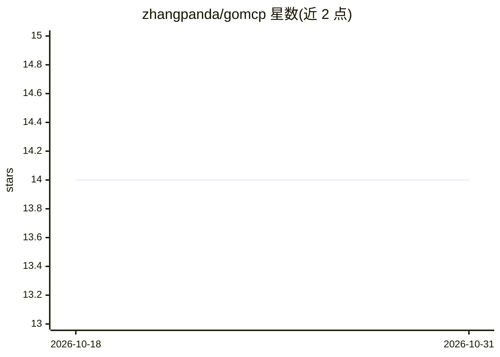

# zhangpanda/gomcp

⭐ 14 · Go · Apache-2.0 · 推送 2026-09-18 · [GitHub](https://github.com/zhangpanda/gomcp) · [官网](https://modelcontextprotocol.io) · 个人维护 · 中文 README

**Go 语言 MCP 服务器构建框架：struct-tag 自动生成 schema**

面向 Go 开发者的 Model Context Protocol 服务器框架，定位为'Gin for MCP'而非 SDK。核心机制：通过 mcp struct 标签自动生成 JSON Schema 并做参数校验（required/min/max/enum/pattern）、类型化 handler、中间件链（Logger/Auth/RateLimit/OTel）、工具分组与 RBAC、组件版本管理与异步任务。提供 Gin/OpenAPI/gRPC 三种适配器，一行代码把已有 API 导入为 MCP 工具。支持 stdio 与 Streamable HTTP 传输，内置 Inspector 调试 UI 与 mcptest 测试包。要求 Go ≥ 1.25，认证失败以 isError=true 的 JSON-RPC result 返回而非 HTTP 401/403，会话状态仅存内存且 30 分钟空闲后清除。

## 筛选速览

| 维度 | 判定 | 备注 |
|---|---|---|
| AI 角色 | `ai-ecosystem` | LLM/agent 周边工具 |
| 许可风险 | `permissive` | Apache-2.0 |
| 部署形态 | `None` |  |
| 模型依赖 | — | README 未给出锁定关系 |
| 硬件要求 | — | 无带数字的原话,不猜 |
| 安装摩擦 | `low` | 无编译、无系统依赖或容器化 |
| 成熟度 | — | 结构信号不足 |

## 能力要点

- mcp struct 标签自动生成 JSON Schema 并在 handler 前校验参数
- Gin/OpenAPI/gRPC 适配器：一行导入已有 API 为 MCP 工具
- 中间件链 + Bearer/APIKey/Basic 认证 + RBAC 工具组授权
- stdio 与 Streamable HTTP 传输、内置 Inspector 调试 UI、mcptest 快照测试包

## 适用场景

- 为 Claude Desktop/Cursor 等 MCP 客户端编写 Go 工具服务器
- 把现有 Gin 路由、OpenAPI 文档或 gRPC 服务导入为 MCP 工具
- 在生产环境部署带认证、限流与可观测性的 MCP 服务器

## 场景标签

 · 领域:AI 基础设施/MCP 框架

## 证据(README 行号)

> L20: GoMCP is a **framework** for building Model Context Protocol (MCP) servers — not just an SDK. Think of it as **"Gin
> L22: MCP is the open protocol that lets AI applications (Claude Desktop, Cursor, Kiro, VS Code Copilot) call external to
> L8: **The fast, idiomatic way to build MCP servers in Go.**

## 星数曲线

2026-10-18 14 → 2026-10-31 14（+0）

---
*卡片 v1 · prompt 1.4 · 生成 2026-10-31 · 置信度 high · 依据 README sha `7f5de8f684c3` · [字段定义](../../DATASET.md)*
