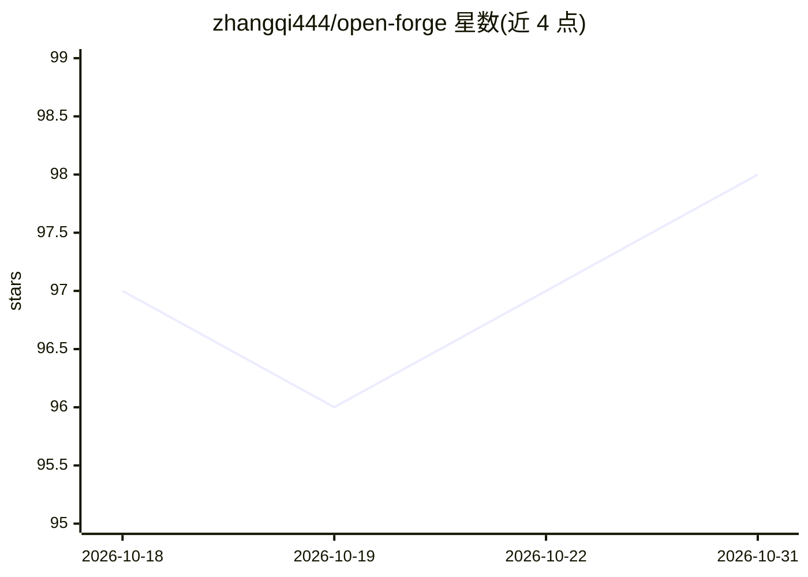

# zhangqi444/open-forge

⭐ 98 · Shell · MIT · 推送 2026-06-03 · [GitHub](https://github.com/zhangqi444/open-forge) · 个人维护

**让 AI 编程助手自托管开源应用的技能与配方库**

一个 Claude Code 插件/技能，包含 2,200+ 条经过验证的开源应用自托管配方：由 AI 编程助手按配方驱动 aws/gcloud/kubectl/docker/ssh 等 CLI，完成服务器开通、DNS、TLS、SMTP、安全加固直至应用上线。配方同样适配 Codex、Cursor、Aider、Continue、OpenClaw、Hermes 等平台。部署过程可跨会话恢复（状态文件），结束后生成脱敏 issue 供用户审核共享，由 AI agent 补丁配方形成自改进目录。自主 agent 模式下禁用聊天粘贴凭据。

## 筛选速览

| 维度 | 判定 | 备注 |
|---|---|---|
| AI 角色 | `ai-ecosystem` | LLM/agent 周边工具 |
| 许可风险 | `permissive` | MIT |
| 部署形态 | `None` |  |
| 模型依赖 | locked-api |  |
| 硬件要求 | — | 无带数字的原话,不猜 |
| 安装摩擦 | `low` | 无编译、无系统依赖或容器化 |
| 成熟度 | — | 结构信号不足 |

## 能力要点

- 2,200+ 验证配方，覆盖 AI 栈、出版、生产力、媒体等自托管应用
- 部署工作流分阶段且可跨会话恢复（状态文件 ~/.open-forge/deployments/）
- 凭据处理按安全度分五级模式，自主 agent 模式禁用聊天粘贴
- 部署后生成脱敏 issue，经审核后由 AI agent 补丁配方并开 PR

## 适用场景

- 让 Claude Code 替我在云服务器上部署自托管应用
- 在 Cursor/Aider 等工具中复用同一套部署配方
- 跨云（AWS/Hetzner/DO 等）以一致流程部署同一应用

## 场景标签

`工作流自动化` · 领域:效率与自动化

## 证据(README 行号)

> L5:  A Claude Code skill that self-deploys 2,200+ open-source apps to your own infrastructure.
> L16: > No more reading a 30-step README and copy-pasting bash for hours. You stay in chat; Claude Code drives the CLIs (
> L46: Claude Code is the canonical home, but the same recipes ship for other agents — see `docs/platforms/`:

## 星数曲线

2026-10-18 97 → 2026-10-31 98（+1）

---
*卡片 v1 · prompt 1.4 · 生成 2026-10-23 · 置信度 high · 依据 README sha `6471c150aae7` · [字段定义](../../DATASET.md)*
