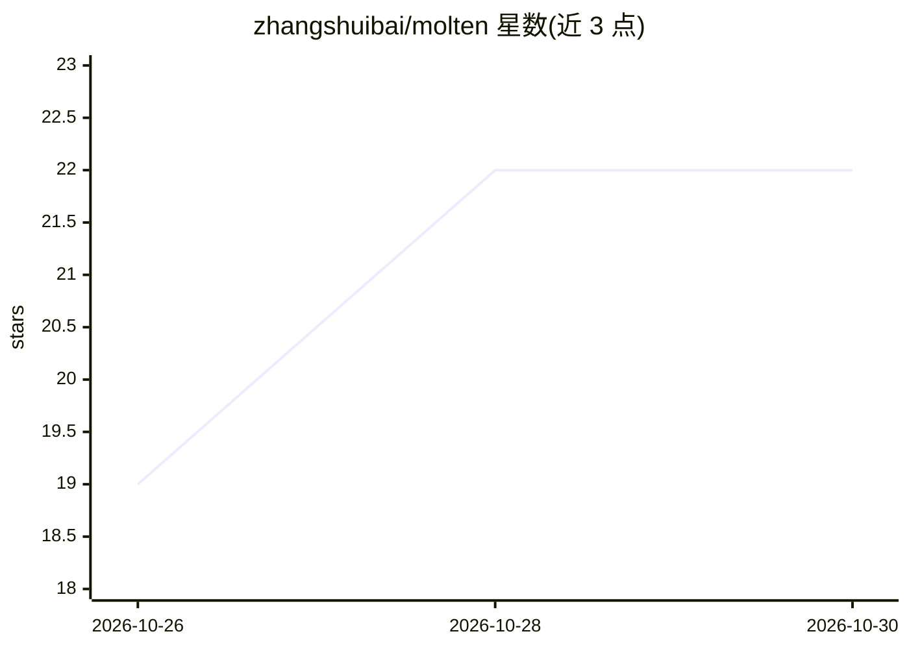

# zhangshuibai/molten

⭐ 22 · Metal · Apache-2.0 · 推送 2026-10-29 · [GitHub](https://github.com/zhangshuibai/molten) · 个人维护

**Apple Silicon 上运行 LFM2.5-24B-A2B 的 Rust+Metal 推理引擎**

面向 LiquidAI LFM2.5-24B-A2B（24B 参数、2B 激活）模型的专用推理引擎，用 Rust + Metal 实现，仅约 6 MB 单二进制，不依赖 Python/PyTorch/MLX。提供 CLI、交互式聊天和 OpenAI 兼容服务器（流式、reasoning 输出、tool calls）。通过模型专属 kernel 融合、GPU 常驻 decode 循环、固定形状 kernel 与零拷贝权重做性能优化。限制：仅支持 M5 系列 Mac（macOS 26+、24GB+ 内存），仅此一个模型，单序列无 batching。

## 筛选速览

| 维度 | 判定 | 备注 |
|---|---|---|
| AI 角色 | `ai-ecosystem` | LLM/agent 周边工具 |
| 许可风险 | `permissive` | Apache-2.0 |
| 部署形态 | `None` |  |
| 模型依赖 | — | README 未给出锁定关系 |
| 硬件要求 | — | 无带数字的原话,不猜 |
| 安装摩擦 | `medium` | 含编译或系统依赖之一 |
| 成熟度 | — | 结构信号不足 |

## 能力要点

- 单二进制纯 Rust + Metal 实现，约 6 MB，无 Python/PyTorch/MLX 依赖
- OpenAI 兼容服务器，支持流式、reasoning 输出与 tool calls
- 与 mlx-lm 逐 token 对齐的数值一致性，MATH-500/IFEval 分数与官方发布一致
- 内存映射官方 MLX 4-bit checkpoint，零拷贝使用

## 适用场景

- 在 M5 系列 Mac 上本地运行 LFM2.5 做编码与推理任务
- 通过 OpenAI 兼容 API 在本地为编码 agent 提供模型服务
- 需要高解码速度与低首 token 延迟的本地推理场景

## 场景标签

`推理引擎` · 领域:训练与推理

## 证据(README 行号)

> L5: Molten is a native **Rust + Metal** inference engine for
> L18: - **Ready to use.** A CLI, an interactive chat and an OpenAI-compatible server with streaming, reasoning output and
> L39: ./molten serve --model ~/models/lfm2.5 --port 8080              # OpenAI-compatible API

## 星数曲线

2026-10-26 19 → 2026-10-30 22（+3）

---
*卡片 v1 · prompt 1.4 · 生成 2026-10-28 · 置信度 high · 依据 README sha `e99e6ff046fb` · [字段定义](../../DATASET.md)*
